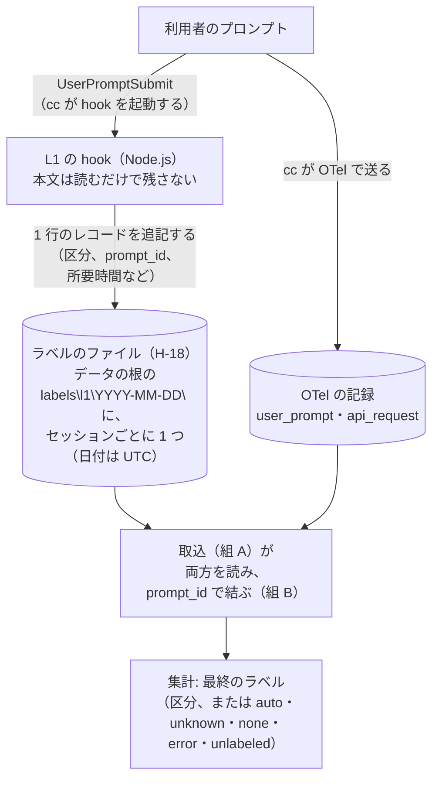

# 作業分類タグ 設計書（組 C）

| 項目 | 内容 |
|---|---|
| 位置付け | Phase 2（設計）の組 C の設計書である。[計画書 v2.4](../../00.活動計画/活動計画書.md) の Phase 2「[作業分類タグ](../../00.活動計画/活動計画書.md#sec-p2-tag)」と「[L1 の hook の既定の書き方](../../00.活動計画/活動計画書.md#sec-p2-l1-hook)」を、[割り当て表](../99.設計まとめ/【別紙】割り当て表.md#sec-1)の組 C の 19 行ごとに決める。[統合の設計書](../99.設計まとめ/設計書.md)は、本書の決めごとを写さずにここを指す |
| 状態 | v0.3（2026-10-27）。判断の節目の裁定（[J-32](../作業指示者裁定待ち事項.md#sec-1) ほか）と、組の間のそろえ（[統合 §3.2](../99.設計まとめ/設計書.md#sec-3-2)）を入れ、クロスレビュー（2026-10-27）の指摘を直した。作業指示者の承認の前（設計書の承認の回に、統合の設計書とあわせて承認していただく） |
| 想定読者 | 作業指示者（設計書の承認の回に本書を承認する。分類体系は J-32 で決めた。[§0](#sec-0) で要点を、[§1.1](#sec-1-1) で分類体系の決定を確かめられる）、統合と組 A・B・D の担当、Phase 3 で L1 の試作の hook を作る担当（いずれも Claude）。どの読者も本活動の文脈を持つ前提である |
| 前提 | 計画書 v2.4 が正本（2026-10-26 承認）。今の基線は cc 2.1.310・docs ed2bfc5 で、[1-10](../../01.基礎調査/10.cc2.1.310差分の確認/調査報告書.md) の D68 と [§4](../../01.基礎調査/10.cc2.1.310差分の確認/調査報告書.md#sec-4) の P5 を考えに入れた（計画書への反映は v2.5 の案。[進め方 P2-4](../00.設計の進め方/計画書.md#sec-p2-4)）。作業指示者が決める事項の線引きは[進め方 P2-3](../00.設計の進め方/計画書.md#sec-p2-3)、行の割り当ては割り当て表 v0.6 による。判断の節目の 6 件は 2026-10-27 に裁定された（正本は[判断事項 §1](../作業指示者裁定待ち事項.md#sec-1) の「裁定」の欄） |
| 関連資料 | [Phase 2 の進め方](../00.設計の進め方/計画書.md)（以下「進め方」）、[割り当て表](../99.設計まとめ/【別紙】割り当て表.md)、[Phase 2 の判断事項のファイル](../作業指示者裁定待ち事項.md)（以下「判断事項」）、[統合の設計書](../99.設計まとめ/設計書.md)（以下「統合」）、[組 A 全体構成](../01.全体構成/設計書.md)（以下「組 A」）、[組 B データモデルと集計](../02.データモデルと集計/設計書.md)（以下「組 B」）、[組 D 有効化とデータ保全](../04.有効化とデータ保全/設計書.md)（以下「組 D」）、[1-3 作業分類タグの付与方式](../../01.基礎調査/03.作業分類タグ方式/調査報告書.md)（以下「1-3」）、[1-10](../../01.基礎調査/10.cc2.1.310差分の確認/調査報告書.md)、[まとめ §2](../../01.基礎調査/99.基礎調査まとめ/報告書.md#sec-2)・[§3.4](../../01.基礎調査/99.基礎調査まとめ/報告書.md#sec-3-4)、[Phase 1 の裁定待ち事項](../../01.基礎調査/作業指示者裁定待ち事項.md#sec-1)（J-3・J-12・J-15）、[V-ID 別紙 §2](../../01.基礎調査/99.基礎調査まとめ/【別紙】V-ID別状況とPhase3実測項目.md#sec-2)、[仕様別紙](../../00.活動計画/【別紙】公式仕様の調査結果.md)（§3 は hook の docs の事実） |

**読み方**

| 読者 | 読む所 | 読了目安（600〜800 字/分） |
|---|---|---|
| 作業指示者（設計の要点を知り、承認する） | [§0 要約](#sec-0) | 約 3〜4 分（約 2,600 字） |
| 作業指示者（分類体系の決定と、注記の扱いを確かめる） | [§0](#sec-0) → [§1.1 分類体系](#sec-1-1) | 約 9〜12 分（約 7,100 字） |
| 統合と組 A・B・D の担当 | [§0](#sec-0)、[§3 対応表](#sec-3)、[§4 受け渡し](#sec-4) | 約 10〜14 分（約 8,100 字） |
| Phase 3 の担当 | 全体。特に [§1.2](#sec-1-2)〜[§1.7](#sec-1-7)、[§2](#sec-2)、[§4.1](#sec-4-1)、[§5](#sec-5) | 全体で約 26,000 字 |

**目次**

| 節 | 中身 |
|---|---|
| [0. 要約](#sec-0) | 目的とスコープ、成功条件と打ち切り条件、決めたこと、作業指示者が決めたこと、決めずに残すこと |
| [1. 作業分類タグ](#sec-1) | 分類体系（J-32）、L1 の実装手段、ラベルの持ち方、自動開始のターン、command のターン、所要時間の記録、L2 のデバッグモード |
| [2. L1 の hook の既定の書き方](#sec-2) | 既定の 9 点への決定、足す 5 点、settings に書く形、スクリプトの処理の順 |
| [3. 割り当て表との対応表](#sec-3) | 組 C の 19 行の状態と、決めた節 |
| [4. 受け渡し](#sec-4) | 本書が正本の H-18〜H-20・H-28・H-29・H-31 の値、他の組が正本の行の使い方 |
| [5. 未確認・【推定】に依った決めごと](#sec-5) | 依った事柄と、確かめる時期 |
| [6. Devil's Advocate](#sec-6) | 主な決めごとへの最強の反論 |

<a id="sec-0"></a>
## 0. 要約

本書は、作業分類タグのうち L1（`UserPromptSubmit` の hook の中でプロンプトを規則で分類し、ラベルだけを保存する）の作り方を中心に、割り当て表の組 C の 19 行を決める。18 行を決め（TG-01 と、S7-06 の分類体系の部分は、作業指示者の裁定 J-32 による）、1 行（TG-09）を Phase 3 の結果で決める。あわせて、受け渡しの H-28（`SessionStart` の hook の置き方）と H-31（L2 の切り替えの設定の置き場所）を決める。H-29（`plan_usage_snapshot` を Mod で埋めるか）は、日常では埋めず、日常で埋めるかは Phase 4 に進むかの判断のときに決める。計画書の既定の案を覆した行は無い。

<a id="sec-0-1"></a>
### 0.1 目的とスコープ

- 目的: [計画書 §1.3](../../00.活動計画/活動計画書.md#sec-1-3) の「作業分類 × モデル × effort」の集計のうち「作業分類」を、Phase 3 で試作できるところまで決める
- 対象: 割り当て表の組 C の 19 行（TG-01〜TG-09、L1-01〜L1-09、S7-06）と、本書が正本の受け渡し H-18〜H-20・H-28・H-29・H-31
- 対象外
  - ラベルの列名とスキーマ（組 B。H-01）、収集データのフォルダの構成（組 A。H-07）、hook のスクリプトの置き場所（組 A。H-27）、内容を記録する変数の置き場所（組 D。H-13・H-14）
  - L1 を正式リリース物の既定にしてよいかの判定（[J-12](../../01.基礎調査/作業指示者裁定待ち事項.md#sec-1)。Phase 3 の測定で行う）

<a id="sec-0-2"></a>
### 0.2 成功条件と打ち切り条件

- 成功条件
  - 19 行のどれもが、決めた / 作業指示者に諮る / 決めない（理由と時期）のどれかになっている（[§3](#sec-3)）
  - H-18〜H-20・H-28・H-29・H-31 の値（置き場所、形式、項目、値）が決まっている（[§4.1](#sec-4-1)）
  - Phase 3 の担当が、本書と [V-ID 別紙 §2 の L1 の試作の hook の仕様](../../01.基礎調査/99.基礎調査まとめ/【別紙】V-ID別状況とPhase3実測項目.md#sec-2-l1-hook)から、L1 の試作の hook を作れる
- 打ち切り条件: Q の回答・J の裁定で決まったこと（J-3・J-12・J-15、[Q4 の ※2](../../01.基礎調査/99.基礎調査まとめ/報告書.md#sec-5-1-answers)）を変える必要が出たら、書かずに止めて main に返す（[進め方 §0.3](../00.設計の進め方/計画書.md#sec-0-3)）。本書の執筆では当たらなかった

<a id="sec-0-3"></a>
### 0.3 決めたこと

- L1 の実装手段は command hook にする。Node.js のスクリプトを exec 形式で動かす。Mod は Phase 3 で J-12 の比較のために作り、command hook が J-12 の基準を超えたときの代わりの候補にする（[§1.2](#sec-1-2)）
- L1 と L2 のラベルは、計画書の既定の案のとおり別の列で持つ（[§1.3](#sec-1-3)）
- cc が自分で始めたターンかどうかは、hook で判定しない。hook は区分を求めて記録するだけにし、最終のラベル（区分、「自動」、`unknown` など）は集計の側で付ける（[§1.4](#sec-1-4)）
- `UserPromptExpansion` の hook は足さない。command の名前は、`UserPromptSubmit` の入力の打ったままの行から取る（[§1.5](#sec-1-5)）
- hook は自分の所要時間を、ラベルと同じレコードに書く（[§1.6](#sec-1-6)）
- L2 のデバッグモードは、事後分類と、L2 のラベルの集計への出力を 1 つの設定で切り替える。本文の記録は切り替えに入れない（[§1.7](#sec-1-7)）。設定は、データの根の `config\` の 1 つのファイルに置き、受信サーバと取込が読む（[§4.1](#sec-4-1) の H-31）
- hook の書き方は、計画書の既定の 9 点をすべて採り、5 点（1-10 の P5 の 3 点、stderr の扱い、`timeout` の明示）を足す（[§2](#sec-2)）
- `SessionStart` の hook は、L1 の hook と同じ規則の Node.js のスクリプトにし、ユーザ settings に置く（[§4.1](#sec-4-1) の H-28）
- `plan_usage_snapshot` は、日常では Mod で埋めない。Phase 3 で、L1 の Mod 版と別の Mod で記録を試す（[§4.1](#sec-4-1) の H-29）

<a id="sec-0-4"></a>
### 0.4 作業指示者が決めたこと

| 事項 | 決めたこと（裁定） | 採らなかった案 | 詳しくは |
|---|---|---|---|
| 分類体系の初期カテゴリ（進め方 P2-3 の 4。TG-01 と S7-06 の一部） | 案 A（[J-32](../作業指示者裁定待ち事項.md#sec-1)。2026-10-27。Claude の推奨どおり）。作業の性質で 8 区分に分け、4 つの群にまとめる。区分の外の値（該当なし・継続・失敗・未付与）の扱いと見直しの手順も、Claude の案のまま。各区分は「モデル選定原則」の表と [check-model](../../../../.claude/skills/check-model/SKILL.md) の判定基準の、今の行に当てた。作業指示者の注記（これらの還流先は仮説を元に作ったもので、本仕組みの定量評価で見直す。絶対のものとして扱わない）の扱いは §1.1 にある | B（群の 4 区分だけ）、C（2 つの軸）、D（作業指示者の作業の分け方）。長所と短所は §1.1 の選択肢の表 | [§1.1](#sec-1-1) |

<a id="sec-0-5"></a>
### 0.5 決めずに残すこと

| 事項 | 理由 | 時期 | それまでの仮置き | 決まったときに直す範囲 |
|---|---|---|---|---|
| cc が自分で始めたターンの判定規則（TG-09） | Phase 3 で hook の入力と `user_prompt` の中身（`prompt_id` が付くか、`prompt.id` と一致するか）を確かめてから決める（計画書の「Phase 3 の結果で決める」） | Phase 4 に進むかの判断のとき（[進め方 P2-2](../00.設計の進め方/計画書.md#sec-p2-2)） | どのターンも判定できないので、J-15 のとおり最終のラベルを `unknown` にする。hook のレコードは、組 B の元の表 `l1_hook_record` に 1 件 1 行で残り（[組 B §6.1](../02.データモデルと集計/設計書.md#sec-6-1) の H-01）、記録した区分（`category`）を Phase 3 の L1 と L2 の比較に使う | 集計の判定規則の版を上げ、記録した材料から過去の分も付け直す。本文の形に依る印が要るなら、hook にその印の計算を足す（[§1.4](#sec-1-4)）。手掛かりが見つからず規則が作れない場合は、J-15 の既定のとおり、分析の注記にして J-15 を改めて諮る |
| L1 を plugin で配るか（職場） | 職場の managed settings の設定が分からない（[1-3 §2](../../01.基礎調査/03.作業分類タグ方式/調査報告書.md#sec-2) の管理・版の条件の行） | Phase 7 の着手前 | 本環境はユーザ settings の command hook | 配る形と、settings に書く形（[§2.2](#sec-2-2)） |
| L2 の事後分類に LLM を使うか | L1 と同じ規則で、L1 と L2 の差がどれだけ出るかを先に見る | Phase 3 の L1 と L2 の比較の後 | L1 と同じ規則で分類する | [§1.7](#sec-1-7) の L2 の事後分類 |
| `plan_usage_snapshot` を日常に Mod で埋めるか（H-29） | 記録の中身が docs だけによるので、Phase 3 で別の Mod で記録して確かめてから決める | Phase 4 に進むかの判断のとき | 日常では埋めない。使用量の上限の消費は見なし費用で代える | [§4.1](#sec-4-1) の H-29 と、組 B の表 `plan_usage_snapshot` の扱い（[組 B §1.11](../02.データモデルと集計/設計書.md#sec-1-11)） |

<a id="sec-1"></a>
## 1. 作業分類タグ

計画書の小節「作業分類タグ」の行（TG-01〜TG-09）を決める。TG-06（hook の書き方）は [§2](#sec-2) で決める。仕組み全体の中での hook の位置は、[統合 §1.2](../99.設計まとめ/設計書.md#sec-1-2) の図 2 にある。L1 の流れは次のとおりである。



図は、hook がラベルのファイルに書き、取込と集計がそれを OTel のデータと `prompt_id` で結んで最終のラベルを付ける順を示す。L2 は hook を使わず、OTel の `user_prompt` の本文を集計の側で分類する（[§1.7](#sec-1-7)）。

本書の「集計」「集計の側」は hook の外の処理を指す。最終のラベルと L2 の分類は、取込 lmo-ingest が S1 の `prompt_label` を作るときに付ける（[組 A §2.3](../01.全体構成/設計書.md#sec-2-3)、[統合 §3.2](../99.設計まとめ/設計書.md#sec-3-2)）。

<a id="sec-1-1"></a>
### 1.1 分類体系（TG-01。J-32 で決めた）

分類体系の初期カテゴリは、作業指示者が決めた（[進め方 P2-3](../00.設計の進め方/計画書.md#sec-p2-3) の 4）。本書では、カテゴリを「区分」、区分をまとめた上の段を「群」と呼ぶ。

**決めたこと**（[J-32](../作業指示者裁定待ち事項.md#sec-1) の裁定。2026-10-27）

- 案 A: 作業の性質で 8 区分に分け、4 つの群にまとめる。区分の一覧（区分、群、中身）と、1 つのプロンプトに複数の区分が当たるときの優先の順は、下の「案 A の区分」のとおり
- 区分に当たらないときの値の扱い（下の「区分の外の値」）と、分類体系の見直しの手順（下の「見直しの手順」）は、Claude の案のまま
- 裁定の対象の外（決めないもの）
  - 規則（キーワードと command の名前の対応）の中身。Claude が版を付けて作り、直す
  - 値 `auto`（「自動」）と `unknown`。J-15 の裁定による（[§1.4](#sec-1-4)）
  - L1 の実装手段（Claude が決めた。[§1.2](#sec-1-2)）

**理由**: 裁定は Claude の推奨（案 A）のとおりである。推奨の理由は下の「Claude の推奨」、採らなかった案 B〜D の長所と短所は下の選択肢の表にある。

**作業指示者の注記**（J-32 の裁定に付いたもの）: 「モデル選定原則」の考え方と check-model の判定基準は、どちらも仮説を元に作ったものである。本仕組みが完成したら、本仕組みを使った定量評価を元に見直し・精緻化する予定なので、これらの考え方・基準を絶対のものとして扱わない。本書では、区分と還流先の行の対応を固定せず、還流先が改訂されたら見直す（下の見直しの手順のきっかけ。全体での扱いは[統合 §2.2](../99.設計まとめ/設計書.md#sec-2-2)）。

**選択肢**

| 案 | 中身 | 長所 | 短所 |
|---|---|---|---|
| A（推奨） | 作業の性質で 8 区分に分け、4 つの群にまとめる（下の表） | 区分が還流先の行（「モデル選定原則」の表、check-model の判定基準）に当たり、分析の結果をその行に返せる。群でも集計できる | 規則の作り込みが要る。区分の境（設計と執筆、調査とレビューなど）で誤りやすい |
| B | 群の 4 区分だけ | 規則が少なく、誤りが少ない。区分あたりの標本が厚い | 還流先の行（設計判断とクロスレビュー、調査と執筆など）を分けられない |
| C | 2 つの軸（作業の性質 × 対象（文書・コード・設定・データ）） | 集める情報が多い | 1 つのプロンプトに 2 つの規則を当てる。区分 × モデル × effort の組あたりの標本が薄くなる |
| D | 作業指示者の作業の分け方（例: 計画・調査・設計・実装・レビュー・運用）で一覧を出していただき、Claude が規則と還流先の対応を作る | 作業指示者の感覚に合う | 還流先の行との対応を別に作る必要がある。節目の判断に時間がかかる |

**Claude の推奨**: 案 A。

- 最終ゴールは「作業の性質 → 推奨モデル × 推奨 effort」で、還流先の無い分析はしない（[計画書 §1.1](../../00.活動計画/活動計画書.md#sec-1-1)）。案 A の区分は、ルートの [CLAUDE.md](../../../../CLAUDE.md) の「モデル選定原則」の表と [check-model](../../../../.claude/skills/check-model/SKILL.md) の判定基準の行に当たる
- 区分の上に群（案 B の粒度）を持つので、標本が薄い区分は群で集計できる。[計画書 Phase 6](../../00.活動計画/活動計画書.md#sec-p6) の「サンプル数が少ない分類は結論を保留する」とも合う
- 区分を分ける直しは、L1 では後からできない（本文が残らない）。初めは細かめに持ち、群で畳む方が、後で直す費用が小さい

**案 A の区分（初版）**: 「還流先の行」の列は今の還流先の行で、正しい対応と決まったものではない（上の作業指示者の注記）。

| 群 | 区分の値 | 表示名 | 中身 | 規則の初版の例 | 還流先の行 |
|---|---|---|---|---|---|
| 判断 | `review` | レビュー | クロスレビュー、論理整合性の確認、コードレビュー、指摘への対応の判断 | 「レビューして」「指摘」、`/review-skill-request` | モデル選定原則の「論理整合性レビュー・大規模統合・設計判断」「クロスレビューでの観点分担」、check-model の Opus |
| 判断 | `design` | 設計・計画 | 方針・設計・計画の判断、案の比較、仕組み化の設計 | 「設計して」「方針を」「案を出して」「比べて」、`/mechanism-builder`・`/5-whys` | モデル選定原則の「論理整合性レビュー・大規模統合・設計判断」、check-model の Opus |
| 実装 | `impl` | 実装・デバッグ | コード・スクリプト・設定の実装、デバッグ、リファクタリング、テスト | 「実装して」「バグ」「テストして」「スクリプトを」 | check-model の Sonnet（通常の実装・デバッグ・リファクタリング） |
| 実装 | `verify` | 実機検証・計測 | probe、実測、動作の確認 | 「実機で」「probe」「測って」「動作確認」 | 当たる行が無い（Phase 6 で行を足す候補） |
| 読み書き | `writing` | 執筆・反映 | 報告書・計画書などの執筆、改訂、指摘の反映 | 「書いて」「反映して」「改訂して」「追記して」 | 当たる行が無い（同上） |
| 読み書き | `research` | 調査 | docs・Web・コード・データを読んで調べ、まとめる | 「調べて」「調査して」「読んで」「まとめて」 | モデル選定原則の「ファイル探索・パターン検索」「機械的な情報抽出・要約・整形」、check-model の Sonnet（調査と要約） |
| 操作 | `ops` | 操作・運用 | git の操作、コミット・PR、環境の設定、ファイルの移動 | 「コミットして」「push」「ブランチを」「インストールして」、`/commit-and-pr` | check-model の Haiku（単純な変換・整形、決定論的 lookup） |
| 操作 | `chat` | 質問・相談 | 短い質問、用語の確認、相談 | 「とは」「教えて」、「？」で終わる短い文 | check-model の Haiku（軽量な質問への応答） |

- 優先の順は、表の上から下（判断 → 実装 → 読み書き → 操作）にする。1 つのプロンプトが判断と作業の両方を頼むとき、モデルの選び方が効く判断の側に寄せるためである。`review` を `design` より先に置くのは、レビューを頼む文が対象の名前（設計書など）を含みやすいためである
- 規則は、動作を表す句（「〜して」の形など）を主に当て、名詞（「設計書」など）だけでは当てない
- 例の command の名前は、本 repo の skill である。ほかの command の対応は、規則の版で足す

**区分の外の値**（Claude の案のまま決めた。J-32）

| 値 | 表示名 | 付くとき | 扱い |
|---|---|---|---|
| `none` | 該当なし | hook は動いたが、どの規則にも当たらなかった | 区分と並べて数える。割合を見直しのきっかけにする |
| `cont` | 継続 | 短い返事（例: 「はい」「OK」「進めてください」「1 で」）で、ほかの規則に当たらない | 集計で、同じセッションの直前の、最終のラベルが区分の値のプロンプトから区分を継ぐ（`auto`・`unknown` などのプロンプトは飛ばす）。継げる区分が無ければ `none` にする。継いだことを記録する |
| `error` | 失敗 | hook が例外を捕まえた（[§2.1](#sec-2-1) の L1-03） | 区分に入れず、件数を見る（hook の不具合の印） |
| `unlabeled` | 未付与 | `user_prompt` があるのに、その `prompt_id` のレコードが無い（付与漏れ。hook が起動しない、タイムアウト、書き込みの失敗） | 集計で付ける。`none`・`error` と分けて数える（hook の失敗を見分けるため。J-15 の理由と同じ） |

`cont` を置くのは、Claude が確認を求め、作業指示者が短く答えて作業が進む形があるためである。短い返事を `chat` や `none` にすると、そのプロンプトで動いた作業の費用がそこに入り、区分ごとの費用が歪む。

**見直しの手順**（Claude の案のまま決めた。J-32）

- 分類体系と規則は、コードに埋めず、版を付けたデータ（1 つの JSON ファイル）で持つ。hook のレコードに、分類体系の版と規則の版を書く（[§4.1](#sec-4-1)）
  - 置き場所は repo の `app/config/taxonomy/taxonomy.json` にする（[組 A §2.6](../01.全体構成/設計書.md#sec-2-6) の規則で本書が決める）。版はファイルの名前に入れず、中の `tax_ver`・`rules_ver` で持つ。hook は、組 A の H-27（[組 A §7.1](../01.全体構成/設計書.md#sec-7-1)）でデータの根に写したものを読む
- 見直しのきっかけ
  - 規則の結果（レコードの `category`。S1 では組 B の `l1_hook_record`）が `none` のプロンプトの割合が、2 週間で 2 割を超えた。判定規則（TG-09）が決まった後は、自動開始のターンを除いて数える（2 割は Claude が置いた初めの値で、Phase 3 の値を見て直す）
  - 本環境で、L1 と L2 の区分の一致の割合が下がった
  - Phase 6 の分析に入る前（一度は必ず見直す）
  - 還流先（「モデル選定原則」の表、check-model の判定基準）が改訂された。区分と行の対応を見直す（上の作業指示者の注記）
  - 作業指示者の求め
- `unlabeled` と `error` の割合は、分類体系ではなく hook を直すきっかけにする
- 規則だけを直すとき: Claude が規則の版を上げる。区分は変わらないので、作業指示者の承認は要らない（変更履歴に残し、次の設計書の承認で見ていただく）
- 区分を足す・分ける・まとめるとき: 作業指示者に諮り、分類体系の版を上げる。旧い版の区分から新しい版の区分への対応表を持つ
  - L1 の過去のラベルは、まとめる直しなら対応表で写せる。分ける直しは写せない（本文が残らない）ので、旧い区分のまま注記する
  - 本環境の L2 は、記録した本文から新しい版で分類し直せる

**直すときの材料**（作業指示者の作業の分け方に合わせて直すとき）

- L1 が見るのは、`UserPromptSubmit` の入力の打ったままの行だけである
  - skill・カスタム slash command は、展開する前の `/名前 引数` の形で届く（docs ed2bfc5 の hooks。[1-3 §2](../../01.基礎調査/03.作業分類タグ方式/調査報告書.md#sec-2)）。区分は command の名前で当てられる
  - 貼り付けた内容は、印の行（`<pasted_content …>` と `</pasted_content …>`）で囲まれて届くことがある（同じ docs）。規則は印の中を見ない（貼り付けたログの語で誤らないため。[§2.3](#sec-2-3)）
  - prompt のファイルを読ませる指示（例: `/read-prompt-file`）では、ファイルの中身が見えないので `none` になる
  - モデルが Skill ツールを呼ぶ経路の skill は、L1 ではなく、ネイティブ属性の `skill.name`（`api_request` の属性。組 B の列）で分ける
- 1 つのプロンプトに付く区分は 1 つである。「調べてから設計して」のように複数の作業を頼むと、優先の順で 1 つに決まる
- 区分を細かくするほど、区分 × モデル × effort の組あたりの標本が薄くなる。群で畳めるので、細かめに置いても集計はできる
- L1 の過去のラベルは分け直せない（上の見直しの手順）。分けるかもしれない区分は、初めから分けておく方がよい
- 区分は還流先の行に当たるように置く。当たらない区分（案 A の `writing`・`verify`）は、Phase 6 で還流先に行を足す候補になる
- プロンプトの先頭に区分を書くと（例: `#design`）、その区分を最優先にする規則も足せる。利用者の操作が増えるので、案 A には入れていない

<a id="sec-1-2"></a>
### 1.2 L1 の実装手段（TG-04。S7-06 の実装手段の部分）

**決めたこと**: L1 の実装手段は command hook にする。Node.js のスクリプトを exec 形式（`"command": "node"` と `args`）で動かす。日常のラベルの元は command hook とする。Mod（`classic.UserPromptSubmit`）は、同じ分類の部品を使って Phase 3 で作り、J-12 の判定（command hook と Mod を別に判定する）のために測る。command hook が J-12 の基準を超えたときに諮る「hook の改善」の候補として残す。

**理由**（比べた材料は [1-3 §4 の L1 の実装手段の比較](../../01.基礎調査/03.作業分類タグ方式/調査報告書.md#sec-4-l1-impl)）

- ラベルの書き出しが確か
  - command hook は、普通のファイル操作で 1 行を追記できる
  - Mod の `$.fs` は追記の method が無く、書き込みが atomic でなく、1 ファイル 4 MiB まで。`$.http.fetch` で送ると、受信サーバが止まっている間のラベルが欠ける（[1-3 §4](../../01.基礎調査/03.作業分類タグ方式/調査報告書.md#sec-4) の L2 の Mod の注）
- 失敗が 1 つのプロンプトに閉じる
  - command hook は、プロンプトごとに別のプロセスで動く
  - Mod は cc のプロセスの中の worker で動き、worker が 3 回止まると、組み込み以外の Mod がすべて unload される。ラベルが黙って欠けうる【推定】（1-3 §4 の実装手段の注 (1)）
- 職場（Phase 7）で止められる条件が少ない
  - `allowManagedModsOnly` は Mod を止めるが、command hook は止めない
  - cache にコピーされる plugin の Mod は、組織が有効にしても利用者の Mod と数えられる（[1-3 §2](../../01.基礎調査/03.作業分類タグ方式/調査報告書.md#sec-2) の管理・版の条件の行）
- 待ち時間はどちらも J-12 の基準より小さい
  - 2.1.302 の対話（Remote Control なし、ユーザ環境の plugin を無効にした状態）の上乗せは、command hook +270 ms、Mod +94 ms（[1-3 §2.1](../../01.基礎調査/03.作業分類タグ方式/調査報告書.md#sec-2-1)。各 n=3）
  - どちらも J-12 の中央値の線（1 秒）の 3 割に満たない
- Node.js で書くのは、exec 形式で Git Bash の有無に依らずに動き、PowerShell で書くときの注意に当たらないためである
  - `node` は実行形式（node.exe）に解決するので、exec 形式で動く。docs は、Windows の exec 形式では `.cmd`・`.bat` を動かせず、`node` にスクリプトのパスを渡す形を勧める（docs ed2bfc5 の hooks の「Exec form and shell form」）
  - PowerShell の文字コードの注意（1-3 §4）と、D68 の引用符の注意（[§2.1](#sec-2-1)）に当たらない。Phase 1 の試作の hook と同じ言語である

**別の案**

| 案 | 長所 | 短所 |
|---|---|---|
| Mod を主にする | 対話の上乗せが小さい（上の値） | 上の書き出し・worker・職場の条件。cc 2.1.293 以降が前提（1-3 §2） |
| PowerShell の command hook | Node.js の無い環境でも動く | スクリプトの文字コードと標準入力の読み方（cc が起動したときは未確認）、`&` の書き方（D68）に注意が要る。起動が Node.js より遅い【推定】 |
| command hook と Mod を同じセッションで常に動かす | 集める情報が多い（[計画書 §1.4](../../00.活動計画/活動計画書.md#sec-1-4) の、本活動では排他でない案を両方作る方針） | 同じ event の hook は並列に走るので、J-12 の上乗せを実装手段ごとに分けられない。両方は作るが、同じセッションでは片方だけを動かす（期間の分け方は Phase 3 の測定の手順で決める。標本の数は V-ID 別紙 §2 の hook の行） |

**比べるときの条件**: command hook と Mod を比べるときは、組み込み Mod の状態と plugin の構成をそろえて測る（計画書の TG-04 の句。1-3 §2.1）。plugin で配る場合は、manifest の名前をほかの plugin と重ねない（[1-8 §7.2](../../01.基礎調査/08.cc2.1.287差分の確認/調査報告書.md#sec-7-2) の D32）。

**本環境での置き方**

- hook はユーザ settings の `hooks` に書き、すべてのリポジトリの日常のセッションで動かす。ユーザ settings に置くものは、Claude が手順を書き、作業指示者が設定する（[活動の CLAUDE.md](../../../CLAUDE.md) の作業時の注意）
- スクリプトの元のファイルは repo の `app/` の下に置き、ユーザ settings が指すのは、repo の外のデータの根に写したものにする。元と写しの置き場所、写すもの、写す担当は組 A の H-27 にある（[§4.2](#sec-4-2)）。写しを指すのは、repo の作業ツリーを直接指すと、ほかのブランチを checkout したときにファイルが無くなり、fail-open なのでラベルが黙って欠けるためである
- ユーザ settings に置くと、Claude が起動する probe と計測用のセッションでも L1 が動き、hook なしの条件が成り立たない。それらのセッションは、ユーザ settings を読まずに起動する（[組 D §1.4](../04.有効化とデータ保全/設計書.md#sec-1-4)）。日常のセッションの hook なしの基準を取る期間の作り方は、Phase 3 の測定の手順で決める。基準を取るため、ユーザ settings には `env` を先に、hook を基準の後に設定する（[組 D §1.7](../04.有効化とデータ保全/設計書.md#sec-1-7)）

<a id="sec-1-3"></a>
### 1.3 ラベルの持ち方（TG-03）

**決めたこと**: 計画書の既定の案のとおり、L1 と L2 のラベルは別の列で持つ。

- L1 の列: 最終のラベル（区分、`cont` を継いだ区分、`none`・`error`・`unlabeled`・`auto`・`unknown`）。付け方は [§4.1](#sec-4-1) の H-20
- L2 の列: 同じ分類体系の区分（L2 の事後分類の結果。[§1.7](#sec-1-7)）
- ネイティブ属性（`skill.name`・`agent.name`・`command_name`）は L1 の列に混ぜず、組 B の別の列のまま持つ
- 列名と型は、組 B の H-01（[組 B §6.1](../02.データモデルと集計/設計書.md#sec-6-1)）にある
- L1 の hook が書くレコードの形は本書が正本で、[§4.1](#sec-4-1) の H-18 にある

**理由**: 本環境では L1 と L2 を両方動かし、並べて比べる（[まとめ §5.1 の回答を受けて決まったこと](../../01.基礎調査/99.基礎調査まとめ/報告書.md#sec-5-1-answers)の確認 4）。

**別の案**: 1 つの列とラベルの出どころの列で持つ。長所は列が少ないこと、短所は同じプロンプトに 2 行が要り、比べる集計が複雑になることである。

<a id="sec-1-4"></a>
### 1.4 cc が自分で始めたターン（TG-05・TG-09。H-20）

**決めたこと**

- [J-15](../../01.基礎調査/作業指示者裁定待ち事項.md#sec-1) の裁定 (A) のとおり、cc が自分で始めたターンにはラベル「自動」を、判定できないターンには `unknown` を付けて残す。どちらにも、人間のプロンプトの規則の区分をラベルにしない
  - データの値は `auto`（表示名「自動」）と `unknown`（表示名 unknown）にする（[§4.1](#sec-4-1) の H-20）。値を ASCII にするのは、ラベルのファイルと集計の SQL で文字コードの扱いを要らなくするためで、表示名は分類体系のデータに持つ
- 判定は hook で行わず、集計の側で行う
  - hook は、どのターンでも区分を求めて記録する（hook の時点では、自動開始のターンかどうかが分からない）
  - 集計で、判定規則が「自動」としたターンには `auto` を、判定できなかったターンには `unknown` を付け、記録した区分はラベルに使わない
- hook が記録する判定の材料: `prompt_id` の有無、`permission_mode`、時刻。本文の形に依る印（例: 自動開始のターンに特有の書き出し）が要ると Phase 3 で分かったら、hook がその印だけを求めて `origin_hint` に記録する（本文は残さない）。それまで `origin_hint` は null にする

**理由**

- 判定の材料の多くは hook の外にある。OTel の `user_prompt` の `command_name`、時刻、Mod を使う場合の `session.receive` の `e.origin.kind` である（[1-3 §4](../../01.基礎調査/03.作業分類タグ方式/調査報告書.md#sec-4) の自動開始ターンの注）
- 判定規則は Phase 3 の後に決まる（TG-09）。hook で判定すると、規則が決まるたびに hook を直すことになり、過去のラベルを付け直せない。集計で判定すれば、記録した材料から過去の分も付け直せる

**別の案**: hook で判定して最終のラベルを書く。長所は集計が簡単になること、短所は上の理由の裏で、材料が足りず、規則の直しが過去に及ばないことである。

**決めないこと（TG-09）**: 判定規則。理由・時期・仮置き・決まったときに直す範囲は [§0.5](#sec-0-5) の表にある。Phase 3 で確かめる材料は次のとおりである。材料の出どころは 1-3 §4 の自動開始ターンの注で、確かめ方の多くは [V-ID 別紙 §2](../../01.基礎調査/99.基礎調査まとめ/【別紙】V-ID別状況とPhase3実測項目.md#sec-2) と [1-8 §8.5](../../01.基礎調査/08.cc2.1.287差分の確認/調査報告書.md#sec-8-5) の表にある。

- 自動開始のターンの hook の入力に `prompt_id` が付くか、OTel の `prompt.id` と一致するか（未確認）
- hook の入力の `prompt` の形と、OTel の `user_prompt` の `command_name` の有無
- scheduled task の時刻（周期からのずれ、`CronList` の次回の時刻）
- Mod を使う場合の `session.receive` の `e.origin.kind` と、`turn.start` の `agentId`

<a id="sec-1-5"></a>
### 1.5 skill・カスタム slash command のターン（TG-07）

**決めたこと**: `UserPromptExpansion` の hook は足さない。`UserPromptSubmit` の入力の `prompt` の先頭が `/` のとき、最初の空白までを command の名前として取り、分類体系の command の対応で区分を当てる。command の名前（引数は含めない）は、レコードの `cmd` に残す。

**理由**

- `UserPromptSubmit` の hook は、skill・カスタム command を打ったときに、その行を打ったまま（例 `/deploy staging`）受け取る（docs ed2bfc5 の hooks の「UserPromptSubmit input」）。名前と引数は、この行から取れる
- hook を 1 つ足すと、利用者が command を打ったプロンプトで所要時間が J-12 の基準に入り、失敗の扱いも 1 つ増える（計画書の TG-07 の句）
- `UserPromptExpansion` だけが持つ項目（`command_source`・`expansion_type`）は、区分を当てるのに要らない

**別の案**: 足す。長所は、名前を解析せずに `command_name`・`command_args` で受け取れることと、`command_source` が取れることである。短所は、上の所要時間と失敗の扱いで、この hook は利用者が打った command の経路でしか動かない（モデルが Skill ツールを呼ぶ経路は `PreToolUse` を通る。[まとめ §2](../../01.基礎調査/99.基礎調査まとめ/報告書.md#sec-2) の作業分類タグ）。

**Phase 3 で確かめること**: skill・slash command を使うターンの `prompt_id` の一致と上乗せ（未確認。まとめ §2）。打ったままの行から名前が取れないと分かったら、この決定を見直す。

<a id="sec-1-6"></a>
### 1.6 hook の所要時間の記録（TG-08。H-19）

**決めたこと**: L1 の hook は、プロンプトごとに自分の所要時間を測り、ラベルと同じレコードの `hook_ms` に書く（形は [§4.1](#sec-4-1) の H-19）。

- 測り始めは、スクリプトから見える最も早い時点にする。Node.js では、process の起動からの経過時間（`performance.now()`。起点が process の起動であることは【推定】）を使う
- 測り終わりは、レコードを書く直前にする。書き込みの時間は含まない
- レコードに実装手段（`command` / `mod`）と hook の版を書き、J-12 で実装手段ごとに分けて判定できるようにする
- S1 では、`hook_ms`・`impl`・`permission_mode` は組 B の元の表 `l1_hook_record` に入り、`prompt_id` で OTel の記録と結べる（[組 B §6.1](../02.データモデルと集計/設計書.md#sec-6-1) の H-01）

**理由**

- 日常のセッションには hook ごとの debug log の行が無い。OTel の `total_duration_ms` は同じ event の全 hook の経過時間で、L1 の分を分けられない（[1-3 §2.1](../../01.基礎調査/03.作業分類タグ方式/調査報告書.md#sec-2-1) の日常に近い条件の注、[J-12 の暫定値](../../01.基礎調査/作業指示者裁定待ち事項.md#sec-1)）
- ラベルと同じレコードにすれば、ラベルと時間が `prompt_id` で 1 対 1 になり、ファイルが 1 種類で済む

**別の案**: 時間を別のファイルに書く。長所はラベルと分けて消せること、短所はファイルが 2 種類になり、突き合わせが要ることである。

**Phase 3 への引き渡し**

- 自分で測る時間は、cc がプロセスを起こす時間を含まない。J-12 の暫定値のとおり、計測用のセッションで debug log の行（`Hooks: UserPromptSubmit [...] finished with status 0 (NNms)` の形）との差を測り、判定では差の中央値を足す（[V-ID 別紙 §2](../../01.基礎調査/99.基礎調査まとめ/【別紙】V-ID別状況とPhase3実測項目.md#sec-2) の hook の行の (6)）
- タイムアウトで取り消された実行は、レコードを書けない（docs ed2bfc5 の hooks: タイムアウトした `UserPromptSubmit` の hook は取り消され、プロンプトは Claude に届く）。遅い実行ほど記録から抜けるので、J-12 の判定では、`unlabeled` の件数と、transcript に出るタイムアウトの通知（同じ docs）を並べて見る

<a id="sec-1-7"></a>
### 1.7 L2 のデバッグモード（TG-02）

**決めたこと**: L2 のデバッグモードは、仕組みの設定の 1 つの切り替え（L2 を有効にする）にし、次の 2 つを一緒に切り替える。cc が本文を記録して送るか（`OTEL_LOG_USER_PROMPTS`）は切り替えに入れない。

- 事後分類の実行
- L2 のラベルの集計への出力（L2 の列と、L1 と L2 を比べる集計）

本環境では常に有効にする（Phase 2 以降の本環境は `OTEL_LOG_USER_PROMPTS=1` で、L1 と L2 を両方動かす。計画書「[作業分類タグ](../../00.活動計画/活動計画書.md#sec-p2-tag)」の回答で決まったこと）。正式リリース物の既定は無効にする（`OTEL_LOG_USER_PROMPTS=0` では L2 は分類できない。[Q4 の ※2](../../01.基礎調査/99.基礎調査まとめ/報告書.md#sec-5-1-answers)）。

この切り替えが無効なら、受信サーバは受信したプロンプトの本文を保存の前に落とす（組 D のマスクの規則 H-04。[組 D §2.3](../04.有効化とデータ保全/設計書.md#sec-2-3)）。誰かが cc の変数を有効にしても、仕組みの側が無効なら本文は残らない。

切り替えの置き場所と形、既定、読む時点は、[§4.1](#sec-4-1) の H-31 にある。受信サーバ（本文を落とすか）と取込（事後分類を行うか）の両方が読む。

**理由**

- 事後分類だけを有効にしても結果を見る所が無く、出力だけを有効にしても出すものが無い
- 本文の記録は cc の環境変数で、cc の起動時に決まり、仕組みの側からは切り替えられない。変数の置き場所と正式リリース物の既定は、[組 D §3.3](../04.有効化とデータ保全/設計書.md#sec-3-3) の決定（[J-31](../作業指示者裁定待ち事項.md#sec-1) の裁定）による（[§4.2](#sec-4-2) の H-13・H-14）

**別の案**: 計画書の挙げる 3 つ（本文の記録、事後分類、出力）を別々に切り替える。長所は細かく選べること、短所は意味の無い組（事後分類だけ、出力だけ）ができることと、本文の記録は仕組みから切り替えられないことである。

**L2 の事後分類**: L1 と同じ分類の部品と規則で始める。L1 と L2 の区分の差が、規則ではなく入力の差（打ったままの行と `user_prompt` の本文、印の扱い）から来るかを、Phase 3 で見られるためである。LLM で分類するかは、Phase 3 の比較の後に決める（[§0.5](#sec-0-5)）。

<a id="sec-2"></a>
## 2. L1 の hook の既定の書き方

計画書の既定の 9 点（L1-01〜L1-09）をすべて採り、5 点を足す（TG-06）。足す 5 点は、計画書 v2.5 の案の「[L1 の hook の既定の書き方](../../00.活動計画/活動計画書.md#sec-p2-l1-hook)」に入った（3 点は 1-10 の P5（D68）、stderr の扱いと `timeout` の 2 点は本書から）。どれも既定を覆すものではない。この書き方の試作の hook が職場で動くかは、Phase 7 で確かめる（[V-ID 別紙 §2 の L1 の試作の hook の仕様](../../01.基礎調査/99.基礎調査まとめ/【別紙】V-ID別状況とPhase3実測項目.md#sec-2-l1-hook)）。

<a id="sec-2-1"></a>
### 2.1 既定の案ごとの決定と、足すもの

**既定の 9 点**

| 行 | 計画書の既定の案（要約） | 本書の決定 | 理由・注 |
|---|---|---|---|
| L1-01 | exec 形式か `"shell": "powershell"` で書き、Git Bash に依らない | exec 形式にする（`"command": "node"`、`args` にスクリプトの絶対パス） | [§1.2](#sec-1-2)。Windows の exec 形式は、`command` が実行形式に解決する必要がある（docs ed2bfc5 の hooks） |
| L1-02 | PowerShell で書く場合は、UTF-8 + BOM で保存し、標準入力を UTF-8 として読む | 採る。PowerShell で書く場合の規則として保つ（今の決定では PowerShell を使わない）。Node.js のスクリプトも、標準入力を UTF-8 として読む | `.ps1` は UTF-8 + BOM + CRLF にする（[win-file-encoding の rule](../../../../.claude/rules/win-file-encoding.md)）。cc が起動したときの標準入力の文字コードは未確認（Phase 3） |
| L1-03 | スクリプトが自分で終える経路は終了コード 0。失敗の処理に 2 を使わない | 採る。スクリプト全体を例外の捕捉で包み、どの経路でも 0 で終える。例外を捕まえたら、`status` が `error` のレコードを書きにいく | 2.1.309 以降、`UserPromptSubmit` の hook が終了コード 2 で終わると、プロンプトが止まる（[1-9 §2](../../01.基礎調査/09.cc2.1.304差分の確認/調査報告書.md#sec-2) の D60） |
| L1-04 | `"onFailure": "continue"` を明示し、`"block"` を付けない | 採る | 終了コード 2 には効かないので、L1-03 と組で使う |
| L1-05 | ラベルは `prompt_id` をキーにし、後の書き込みが前を上書きする形か、集計で重複を除く形にする | 集計で重複を除く形にする。同じ `prompt_id` のレコードが複数あれば、`ts` の最も新しいものを使う | 追記だけで書ける。2.1.308 以前の ctrl+enter のやり直し（[1-9 §2](../../01.基礎調査/09.cc2.1.304差分の確認/調査報告書.md#sec-2) の D63）と、Esc の後の送り直し（D68）に耐える。送り直したときの `prompt_id` が前と同じかは未確認で、違えば届かなかった方のラベルは結合されずに残る【推定】 |
| L1-06 | Mod で実装する場合は `.catch` を付けない。plugin で配る場合は、受け渡しの失敗による拒否がプロンプトに及ぶかを Phase 3 で確かめる | 採る（Phase 3 の Mod 版に当てる）。Mod 版は plugin なので、受け渡しの失敗による拒否も Phase 3 で確かめる。本環境の日常の L1（ユーザ settings の command hook）には及ばない【推定】 | Mod は `.catch` の無い hook の失敗を飛ばして進む（1-3 §4）。受け渡しの失敗による拒否は 2.1.299 からの plugin の hook の扱いで、`.catch` では防げない（[まとめ §2](../../01.基礎調査/99.基礎調査まとめ/報告書.md#sec-2) の作業分類タグ） |
| L1-07 | background の process を起こさない | 採る。書き込みは同期で行い、終わってから終える | 起こすと tool call が block されうる（docs） |
| L1-08 | skill の frontmatter に置かない | 採る。ユーザ settings に置く（[§1.2](#sec-1-2)） | 置くと、その skill を呼んだプロンプトにラベルが付かない |
| L1-09 | plugin で配る場合は marketplace から入れ、skills のフォルダに置かない | 採る（plugin で配る場合の規則）。本環境はユーザ settings に置き、plugin で配るかは Phase 7 の着手前に決める（[§0.5](#sec-0-5)） | `strictPluginOnlyCustomization` のロックで、skills のフォルダの plugin はエラー無しで読み込まれない（1-3 §2） |

**足す 5 点**

| # | 足すこと | 理由 |
|---|---|---|
| 1 | stdout に何も出さない（ログや進み具合も出さない） | `UserPromptSubmit` の hook の平文の stdout は、Claude の文脈に加わる（docs ed2bfc5 の hooks）。加わると、本活動が測る入力トークンが変わる。1-10 の P5 |
| 2 | exec 形式の `command` と `args` の要素に、内側の引用符を付けない | `args` の要素は 1 つずつ引数として渡り、引用符が要らない（同じ docs）。D68 の直し方の 1 つ。1-10 の P5 |
| 3 | PowerShell で `.ps1` を動かす場合は、`"shell": "powershell"` にし、引用符付きのパスの前に `&` を置く | 引用符の文字列だけの command は、PowerShell が実行せずに出力し、ラベルが付かない。その出力が Claude の文脈に加わるかは未確認（D68）。1-10 の P5 |
| 4 | stderr に本文を出さない（例外の文も出さない） | cc 2.1.284 以降、失敗した hook の stderr は debug log に出る（[1-3 §4](../../01.基礎調査/03.作業分類タグ方式/調査報告書.md#sec-4) の失敗時の扱いの注、D11）。例外の文は本文の一部を含みうる |
| 5 | `"timeout"` を 5 秒にする | `UserPromptSubmit` の command hook の既定は 30 秒で、固まった hook は取り消されるまでプロンプトを止める（docs ed2bfc5 の hooks）。5 秒は J-12 の 2 秒の線より上に置き、2 秒を超える遅い実行も記録に残るようにした。取り消されても、プロンプトは Claude に届く |

<a id="sec-2-2"></a>
### 2.2 settings に書く形

ユーザ settings（`~/.claude/settings.json`）の `hooks` に、L1 の hook（`UserPromptSubmit`）と `SessionStart` の hook（[§4.1](#sec-4-1) の H-28）を、次の形で書く。既存の `hooks` があれば、それぞれの event の配列に足す。この設定は、ユーザ settings の `env`（[組 D §1.2](../04.有効化とデータ保全/設計書.md#sec-1-2)）と 1 つの手順（[組 D §1.7](../04.有効化とデータ保全/設計書.md#sec-1-7)）にまとめ、Claude が手順を書き、作業指示者が `env` の後に設定する。

```json
{
  "hooks": {
    "UserPromptSubmit": [
      {
        "hooks": [
          {
            "type": "command",
            "command": "node",
            "args": ["<データの根を展開した絶対パス>\\hooks\\hooks\\l1-tag.mjs"],
            "timeout": 5,
            "onFailure": "continue"
          }
        ]
      }
    ],
    "SessionStart": [
      {
        "hooks": [
          {
            "type": "command",
            "command": "node",
            "args": ["<データの根を展開した絶対パス>\\hooks\\hooks\\session-start.mjs"],
            "timeout": 5,
            "onFailure": "continue"
          }
        ]
      }
    ]
  }
}
```

- `args` が指すのは、データの根の `hooks\` に、`app/` の下のフォルダの構成を保って写したスクリプト（`hooks\hooks\`）である（H-27。[§4.2](#sec-4-2)）。データの根の決め方は[組 A §4](../01.全体構成/設計書.md#sec-4) にある
- exec 形式は shell を通さないので、`%LOCALAPPDATA%` のような環境変数は展開されない。手順の中で展開した絶対パスを書く
- `node` が PATH に無い環境では、`command` に node.exe の絶対パスを書く。空白を含む絶対パスも、1 つの実行形式として扱われる（docs ed2bfc5 の hooks）
- `SessionStart` には matcher を書かず、どの始まり方（`source`）でも動かす（matcher を書かない組は、その event のたびに動く。docs ed2bfc5 L66368）。`source` は記録に残し、使い分けは組 B が決める

<a id="sec-2-3"></a>
### 2.3 スクリプトの処理の順

1. 測り始めの時刻を取る（[§1.6](#sec-1-6)）
2. 標準入力を UTF-8 として全部読み、JSON として解析する
3. `prompt` から、貼り付けの印の行で囲まれた部分を除く。先頭が `/` なら command の名前を取り、command の対応を先に当てる。当たらなければ、先頭の 500 字にキーワードの規則を優先の順に当てる。どれにも当たらず、短い返事の形なら `cont`、それ以外は `none` にする
4. レコード（[§4.1](#sec-4-1)）を作り、測り終わりの時刻から `hook_ms` を入れ、セッションのファイルに 1 行を追記する
5. 終了コード 0 で終える。stdout と stderr には何も出さない

- 2〜4 の例外はすべて捕まえ、`status` が `error` のレコードを書きにいく。書けなくても 0 で終える
- 分類の部品（規則を当てる関数）は、Node.js の API を使わない純粋な関数にし、Mod 版と L2 の事後分類で共有する（Mod は Node.js の API を使えない。1-3 §4 の比較の表）
- 先頭の 500 字に限るのは、長い貼り付けの語で区分を誤らないためと、処理の時間を一定にするためである。字数は規則の版で直せる

<a id="sec-3"></a>
## 3. 割り当て表との対応表

[割り当て表 §1](../99.設計まとめ/【別紙】割り当て表.md#sec-1) の組 C の 19 行の、設計での状態である。main は「状態」の列を割り当て表の「設計での状態」の列に写す。

| ID | 割り当て表の内容（要約） | 状態 | 決めた節 |
|---|---|---|---|
| TG-01 | 分類体系、付与漏れと該当分類なしの扱い、見直しの手順 | 決めた（[J-32](../作業指示者裁定待ち事項.md#sec-1)。案 A。区分の外の値と見直しの手順は Claude の案のまま） | [§1.1](#sec-1-1) |
| TG-02 | L2 のデバッグモードで何を切り替えるか | 決めた | [§1.7](#sec-1-7) |
| TG-03 | L1 と L2 のラベルの持ち方 | 決めた（既定の案のまま。列名は H-01 の組 B） | [§1.3](#sec-1-3) |
| TG-04 | 候補 ② の実装手段（command hook か Mod か） | 決めた（command hook） | [§1.2](#sec-1-2) |
| TG-05 | cc が自分で始めたターンに「自動」、判定できないターンに `unknown` | 決めた（値と付ける所。判定規則は TG-09） | [§1.4](#sec-1-4) |
| TG-06 | hook の書き方 | 決めた（L1-01〜L1-09） | [§2](#sec-2) |
| TG-07 | `UserPromptExpansion` の hook を足すか | 決めた（足さない） | [§1.5](#sec-1-5) |
| TG-08 | hook 自身の所要時間を記録する仕組み | 決めた | [§1.6](#sec-1-6) |
| TG-09 | cc が自分で始めたターンの判定規則 | 決めない。Phase 3 の結果を待つ。Phase 4 に進むかの判断のときに決める | [§0.5](#sec-0-5)、[§1.4](#sec-1-4) |
| L1-01 | exec 形式か `"shell": "powershell"` | 決めた（exec 形式で node） | [§2.1](#sec-2-1) |
| L1-02 | PowerShell の文字コード | 決めた（PowerShell で書く場合の規則として保つ） | [§2.1](#sec-2-1) |
| L1-03 | 終了コード 0、2 を使わない | 決めた | [§2.1](#sec-2-1) |
| L1-04 | `"onFailure": "continue"` | 決めた | [§2.1](#sec-2-1) |
| L1-05 | `prompt_id` をキーにし、上書きか重複除去 | 決めた（集計で重複を除く） | [§2.1](#sec-2-1) |
| L1-06 | Mod なら `.catch` を付けない | 決めた（Phase 3 の Mod 版に当てる） | [§2.1](#sec-2-1) |
| L1-07 | background の process を起こさない | 決めた | [§2.1](#sec-2-1) |
| L1-08 | skill の frontmatter に置かない | 決めた | [§2.1](#sec-2-1) |
| L1-09 | plugin なら marketplace から入れる | 決めた（plugin で配る場合の規則。配るかは Phase 7 の着手前） | [§2.1](#sec-2-1) |
| S7-06 | 計画書 §7 #6 の残り（分類体系と L1 の実装手段） | 決めた（分類体系は J-32 で案 A（TG-01）、実装手段は command hook（TG-04）） | [§1.1](#sec-1-1)、[§1.2](#sec-1-2) |

件数は、決めた 18 行（TG-01 と、S7-06 の分類体系の部分は J-32 の裁定による）、作業指示者に諮る 0 行、決めない 1 行（TG-09）である。計画書の既定の案を覆した行は無い。

<a id="sec-4"></a>
## 4. 受け渡し

<a id="sec-4-1"></a>
### 4.1 本書が正本のもの（H-18〜H-20・H-28・H-29・H-31）

[割り当て表 §2](../99.設計まとめ/【別紙】割り当て表.md#sec-2) で組 C が正本の 6 行である。ほかの組は、ここの値を写さずにリンクで指す。

**H-18 L1 の hook が書くラベルの置き場所と形式**（使う組: A の取込、B の結合）

- 置き場所: `<データの根>\labels\l1\<YYYY-MM-DD>\<session_id>.jsonl`
  - データの根と、`labels` の名前と位置は H-07 による（[§4.2](#sec-4-2)）。その下の形（日付のフォルダとセッションごとのファイル）は本書が正本である
  - 計測用のセッションでは、そのセッションを起こすプロセスが環境変数で渡す、計測のデータの根に書く。Mod 版の置き場所を決めるときも同じにする（[組 D §1.4](../04.有効化とデータ保全/設計書.md#sec-1-4)）
  - 日付は UTC の日付にする（`ts` と同じ UTC にそろえ、フォルダの日付とレコードの時刻を食い違わせないため）
  - セッションごとのファイルにするのは、2 つのセッションの hook が同じファイルに同時に追記したときの行の混ざりを、Windows の追記の振る舞いに頼らずに避けるためである（混ざるかは確かめていない）
  - Mod 版（Phase 3）は `$.fs` に追記が無いので、置き場所とファイルの分け方を Phase 3 の試作で決める。レコードの項目は同じにする
- 形式: UTF-8（BOM なし）、改行は LF、1 行に 1 レコードの JSON。プロンプトの本文はどの項目にも入れない
- 取込（組 A）は、レコードを 1 件 1 行で組 B の元の表 `l1_hook_record` に入れ、同じ `prompt_id` のレコードが複数あれば `ts` の最も新しいものから最終のラベルを作る（L1-05。[組 B §6.1](../02.データモデルと集計/設計書.md#sec-6-1) の H-01）。`prompt_id` が null のレコードは結合せず、件数だけを数える

| 項目 | 型 | 中身 |
|---|---|---|
| `v` | 整数 | レコードの形の版（初版は 1） |
| `ts` | 文字列 | 書いた時刻（UTC、ISO 8601、ミリ秒まで） |
| `impl` | 文字列 | 実装手段。`command` か `mod` |
| `hook_ver` | 文字列 | hook の版 |
| `tax_ver` | 文字列 | 分類体系の版 |
| `rules_ver` | 文字列 | 規則の版 |
| `session_id` | 文字列 | hook の入力の `session_id` |
| `prompt_id` | 文字列か null | hook の入力の `prompt_id`。最初のユーザ入力の前は無い（docs）ので null にする |
| `permission_mode` | 文字列 | hook の入力の `permission_mode`。J-12 の判定の組のキーと、V-ID 別紙 §2 の起動時の permission mode の行に使う |
| `category` | 文字列 | 規則の結果。区分の値か、`none`・`cont`・`error` |
| `rule_id` | 文字列か null | 当たった規則の ID。規則の直しに、本文の代わりに使う |
| `cmd` | 文字列か null | `prompt` の先頭が `/` のときの command の名前（引数は含めない） |
| `origin_hint` | 文字列か null | 自動開始のターンの判定に使う、本文の形から求めた印。TG-09 で要ると決まるまでは null（[§1.4](#sec-1-4)） |
| `hook_ms` | 数 | 自分の所要時間（H-19） |
| `status` | 文字列 | `ok` か `error` |
| `err` | 文字列か null | `status` が `error` のときの、例外の種類の名前だけ（例外の文は本文を含みうるので入れない） |

レコードの例（値は形を示すための仮のもの）:

```json
{"v":1,"ts":"2026-11-02T01:23:45.678Z","impl":"command","hook_ver":"0.1.0","tax_ver":"1","rules_ver":"1","session_id":"<session_id>","prompt_id":"<prompt_id>","permission_mode":"auto","category":"impl","rule_id":"kw-impl-01","cmd":null,"origin_hint":null,"hook_ms":142.7,"status":"ok","err":null}
```

**H-19 hook の所要時間の記録の置き場所と形式**（使う組: 統合。Phase 3 の J-12 の判定へ渡す）

- H-18 のレコードの `hook_ms` に、`impl`・`hook_ver`・`permission_mode` とあわせて書く。置き場所は H-18 と同じである。S1 では組 B の `l1_hook_record` に入り、`prompt_id` で OTel の記録と結べる
- 単位はミリ秒で、小数第 1 位まで。測り始めと測り終わりは [§1.6](#sec-1-6) のとおり
- J-12 の判定では、debug log の行との差の中央値を足して使う（Phase 3 の計測用のセッションで測る）。タイムアウトで取り消された実行のレコードは無い

**H-20 ラベル「自動」と `unknown` の値**（使う組: B のラベルの列）

| 値 | 表示名 | 意味 | 付ける所 |
|---|---|---|---|
| `auto` | 自動 | cc が自分で始めたターン（scheduled task、background subagent の報告、他のセッションからのメッセージ）と判定したもの | lmo-ingest（`prompt_label` を作るとき。判定規則は TG-09） |
| `unknown` | unknown | 自動開始のターンかどうかを判定できなかったもの。判定規則が決まるまでは、どのターンもこれになる | lmo-ingest（同上） |

最終のラベル（L1 の列）は、lmo-ingest が次の順で 1 つに決める。

1. `user_prompt` に対応するレコードが無い → `unlabeled`
2. 判定規則が「自動」とした → `auto`、判定できなかった → `unknown`
3. レコードの `status` が `error` → `error`
4. レコードの `category` が `cont` → 同じセッションの直前の、最終のラベルが区分の値のプロンプトから区分を継ぐ（継げなければ `none`）
5. それ以外 → レコードの `category`（区分の値か `none`）

- 1 を 2 より先に置くのは、hook の失敗（付与漏れ）を自動開始のターンと分けて数えるためである（J-15 の理由）。自動開始のターンでも hook は動く（docs）ので、hook が成功すれば、自動開始のターンにもレコードがある
- `none`・`cont`・`error`・`unlabeled` の値と表示名は、[§1.1](#sec-1-1) の「区分の外の値」の表のとおりである（J-32）。区分の値と一緒に、分類体系のデータに持つ

**H-28 `SessionStart` hook の置き方**（使う組: B の `/clear` の前後の結び付け、D の手順）

- 置き方: `SessionStart` の command hook を、Node.js のスクリプト `session-start.mjs` にし、ユーザ settings の `hooks` の `SessionStart` に置く（書く形は [§2.2](#sec-2-2)）。スクリプトの元と写しの置き場所は H-27 による（[§4.2](#sec-4-2)）
- 書き方: L1 の hook と同じ規則にする。[§2.1](#sec-2-1) の L1-01（exec 形式で node）、L1-03（どの経路も終了コード 0）、L1-04（`"onFailure": "continue"`）、L1-07（background の process を起こさない）と、足す 5 点のうち 1（stdout に何も出さない）、4（stderr に本文を出さない）、5（`"timeout"` を明示する。L1 と同じ 5 秒）
  - stdout に何も出さないのは、`SessionStart` の hook の平文の stdout も、Claude の文脈に加わるためである（docs ed2bfc5 L66987）
  - `"timeout"` を明示するのは、command hook の既定の時間が 10 分で（docs ed2bfc5 L31974）、対話のセッションでは Claude の最初の応答が `SessionStart` の hook の終わりを待つためである（同じ docs の L67421）
- 記録の置き場所: `<データの根>\session-start\<YYYY-MM-DD>\<session_id>.jsonl`（日付は UTC）。`session-start` の名前と位置は H-07 による。追記し、形式は H-18 と同じ（UTF-8・BOM なし、LF、1 行に 1 レコードの JSON）。計測用のセッションでは、H-18 と同じく計測のデータの根に書く（[組 D §1.4](../04.有効化とデータ保全/設計書.md#sec-1-4)）
- 記録の項目: 組 B の `session_start_record` の項目（`session_id`・`source`・`cwd`・`hook_ts`。[定義の別紙 §1.1](../02.データモデルと集計/【別紙】スキーマと指標の定義.md#sec-1-1)）と、レコードの形の版 `v`。`session_id`・`source`・`cwd` は hook の入力の値をそのまま書き、`hook_ts` は書いた時刻（H-18 の `ts` と同じ形）にする

**H-29 `plan_usage_snapshot` を Mod で埋めるか**（使う組: B）

- 日常では埋めない。日常の L1 は command hook で、Mod を日常のセッションで動かさない（[§1.2](#sec-1-2)）
- Phase 3 で、L1 の Mod 版とは別の Mod で `$.session.usage()` を記録し、中身（[組 B §7](../02.データモデルと集計/設計書.md#sec-7) の 6）を確かめる。L1 の Mod 版と分けるのは、J-12 の比較（L1 の上乗せ）に混ぜないためである
- 日常で埋めるかは、Phase 4 に進むかの判断のときに決める（[§0.5](#sec-0-5)）。それまで、使用量の上限の消費は見なし費用で代える（[組 B §1.11](../02.データモデルと集計/設計書.md#sec-1-11) の限り）

**H-31 L2 の切り替えの設定の置き場所と形**（使う組: A の受信と取込、D のマスクの規則）

- 置き場所: `<データの根>\config\lmo-settings.json`（`config` の名前と位置は H-07）
- 形: UTF-8、JSON のオブジェクト。キー `l2_enabled`（真偽値）に、[§1.7](#sec-1-7) の L2 の切り替えを持つ
- 既定: ファイルかキーが無いときは無効（正式リリース物の既定と同じ）。本環境では、Claude が Phase 3 の着手時に有効にして置く
- 読む時点: lmo-receiver は起動のときに読む。値を変えたら、受信サーバを起動し直す。lmo-ingest は取込のたびに読む
- 理由: 受信サーバと取込の両方が読む設定なので、データの根の設定のフォルダに 1 つのファイルで置く。既定を無効にするのは、ファイルが無いときに本文が残らない側に倒すためである

<a id="sec-4-2"></a>
### 4.2 他の組が正本で、本書が使うもの

組 C が使う行のうち、他の組が正本のものである。値は正本の節にあり、本書は使い方だけを書く。

| ID | 受け渡すもの | 正本 | 本書での使い方 |
|---|---|---|---|
| H-01 | L1・L2 のラベルの列（列名・型） | [組 B §6.1](../02.データモデルと集計/設計書.md#sec-6-1) | L1 と L2 を別の列で持つ（[§1.3](#sec-1-3)）。L1 の列に入る値と付け方は、本書の H-20。hook のレコード（H-18）は元の表 `l1_hook_record` に入り、見直しのきっかけ（[§1.1](#sec-1-1)）と J-12 の判定（[§1.6](#sec-1-6)）に使う |
| H-07 | データの根の下のフォルダの構成 | [組 A §4](../01.全体構成/設計書.md#sec-4) | データの根と、ラベル（H-18）と `SessionStart` の記録（H-28）を置く根の直下のフォルダを使う。その下の形は本書が決める |
| H-13 | `OTEL_LOG_USER_PROMPTS` の置き場所（L2 の効く範囲） | [組 D §3.3](../04.有効化とデータ保全/設計書.md#sec-3-3)（J-31 の裁定） | 本環境で L2 が働くセッションの範囲が、この置き場所で決まる（[§1.7](#sec-1-7)） |
| H-14 | 内容を記録する変数の一覧と、正式リリース物の既定 | [組 D §3.3](../04.有効化とデータ保全/設計書.md#sec-3-3)（J-31 の裁定） | 正式リリース物の L2 の切り替えの既定（無効）は、この既定に合う（[§1.7](#sec-1-7)）。`OTEL_LOG_USER_PROMPTS` のほかの変数は、本書では使わない |
| H-21 | 未分類の区分名 | [組 B §6.1](../02.データモデルと集計/設計書.md#sec-6-1) | 未分類の 2 つの区分は、どちらも `prompt.id` で結べない API リクエストの区分で、本書の `unlabeled`（レコードの無いプロンプト。H-20）とは別に数える |
| H-22 | `query_source`・`query_source_safe` の値の体系 | [組 B §6.1](../02.データモデルと集計/設計書.md#sec-6-1) | TG-09 の判定の材料に使うかを Phase 3 で見る（[§1.4](#sec-1-4)） |
| H-27 | hook のスクリプトの置き場所（repo の元と、ユーザ settings が指す写し） | [組 A §7.1](../01.全体構成/設計書.md#sec-7-1) | L1 の hook と `SessionStart` の hook の置き方（[§1.2](#sec-1-2)）と、settings の `args` のパス（[§2.2](#sec-2-2)） |

<a id="sec-5"></a>
## 5. 未確認・【推定】に依った決めごと

| # | 決めごと | 依った事柄 | 印 | 確かめる時期と場所 |
|---|---|---|---|---|
| 1 | command hook を主にする（[§1.2](#sec-1-2)） | worker が止まると Mod がすべて unload され、ラベルが黙って欠ける | 【推定】 | Mod を測る Phase 3（[1-8 §7.5](../../01.基礎調査/08.cc2.1.287差分の確認/調査報告書.md#sec-7-5) の Mod のワーカーの再起動の行） |
| 2 | Node.js で書く（[§1.2](#sec-1-2)） | PowerShell の起動は Node.js より遅い | 【推定】 | PowerShell 版を作る場合の Phase 3 |
| 3 | 自動開始のターンの判定を集計で行う（[§1.4](#sec-1-4)） | 自動開始のターンに `prompt_id` が付き、`prompt.id` と一致する | 未確認 | Phase 3（TG-09） |
| 4 | `UserPromptExpansion` を足さない（[§1.5](#sec-1-5)） | skill・slash command のターンの `prompt_id` が一致し、打ったままの行から名前が取れる | 未確認（行の形は docs の事実） | Phase 3 |
| 5 | 測り始めを process の起動からにする（[§1.6](#sec-1-6)） | `performance.now()` の起点が process の起動である | 【推定】 | Phase 3 の debug log の行との差（差を足すので判定は変わらない） |
| 6 | 集計で重複を除く（[§2.1](#sec-2-1) の L1-05） | Esc で送り直したプロンプトの `prompt_id` が前と同じか。違えば届かなかった方のラベルは結合されずに残る | 未確認・【推定】 | Phase 3 の対話の確認（[1-10 §5.3](../../01.基礎調査/10.cc2.1.310差分の確認/調査報告書.md#sec-5-3)） |
| 7 | セッションごとのファイル（[§4.1](#sec-4-1) の H-18） | 同時の追記で行が混ざる | 未確認（混ざる場合に備えて避けた） | 確かめなくてよい（避けたので結果に依らない） |
| 8 | 足す 5 点の 3（[§2.1](#sec-2-1)） | 引用符の文字列だけの command の出力が、Claude の文脈に加わるか | 未確認 | PowerShell 版を作る場合（1-10 §5.3） |
| 9 | 規則は貼り付けの印の中を見ない（[§2.3](#sec-2-3)） | 作業指示者のセッションで、貼り付けに印の行が付く（docs は、印を付けるセッションでだけ付くと書く） | 未確認 | Phase 3（印が無ければ、先頭の 500 字の限りだけが効く） |
| 10 | 区分の外の値 `cont`（[§1.1](#sec-1-1)） | 短い返事のプロンプトの作業は、直前のプロンプトの作業の続きである | 【推定】 | Phase 3 で L2 の本文と比べる |
| 11 | L1-02 を保つ（[§2.1](#sec-2-1)） | cc が起動したときの PowerShell の標準入力の文字コード | 未確認 | PowerShell 版を作る場合の Phase 3 |
| 12 | 待ち時間はどちらの実装手段も J-12 の基準より小さい（[§1.2](#sec-1-2)） | 本環境の日常の構成では、command hook の上乗せが既存の plugin の hook に隠れうる（判断にはクリーンの条件の値を使った） | 【推定】 | Phase 3（J-12） |
| 13 | 日常の L1 をユーザ settings の command hook に置く（[§2.1](#sec-2-1) の L1-06） | plugin の hook の受け渡しの失敗による拒否は、settings の command hook には及ばない | 【推定】 | Mod 版（plugin）を作る Phase 3（[1-8 §8.5](../../01.基礎調査/08.cc2.1.287差分の確認/調査報告書.md#sec-8-5) の受け渡しの失敗の行） |

件数は 13 件（【推定】6 件、未確認 6 件、両方 1 件）である。Phase 3 でどの run で何を見るかは、[統合の【別紙】Phase 3 で確かめる事柄](../99.設計まとめ/【別紙】Phase3で確かめる事柄.md) にある。

<a id="sec-6"></a>
## 6. Devil's Advocate

| 対象 | 最強の反論 | 棄却根拠 / 残存リスク |
|---|---|---|
| command hook を主にする（[§1.2](#sec-1-2)） | J-12 は対話の日常のセッションで判定し、対話では Mod の上乗せが小さい（+94 ms と +270 ms）。小さい方を主にすべきである | 棄却する。どちらも J-12 の中央値の線（1 秒）の 3 割に満たず、差は判定を分けない（各 n=3 の値）。日常のデータの元には、書き出しの確かさと失敗の閉じ方が効く。Mod も Phase 3 で測り、command hook が基準を超えたら代わりの候補として諮る。残存リスク: 職場は plugin の構成が違い、command hook の上乗せがそのまま出うる（J-12 の暫定値の注） |
| 判定を集計で行う（[§1.4](#sec-1-4)） | hook で判定すれば、本文を記録しない正式リリース物でも本文の形で判定でき、集計の側に本文が要らない | 棄却する。本文の形に依る印が要るなら、hook はその印だけを `origin_hint` に記録する。集計は印を使うので本文は要らず、判定規則が集計にあるので過去の分も付け直せる |
| `UserPromptExpansion` を足さない（[§1.5](#sec-1-5)） | 打ったままの行を解析すると、名前の形（plugin の名前空間の区切りなど）で誤りうる | 棄却する。名前は最初の空白までを取るだけで、名前空間も名前の一部として対応表に当てる。Phase 3 で skill のターンを確かめ、誤りが出たら見直す。残存リスク: `command_source` は取れない（区分には使わない） |
| 案 A の分類体系（[§1.1](#sec-1-1)） | 8 区分では、区分 × モデル × effort の組が薄くなり、Phase 6 で結論が出ない | 残存リスク。群（4 つ）で畳んで集計できるようにした。区分を分ける直しは L1 では後からできないので、初めは細かめに持つ |
| 区分を還流先の行に当てる（[§1.1](#sec-1-1)） | 還流先（「モデル選定原則」、check-model）は仮説で、本仕組みの定量評価で見直す（J-32 の作業指示者の注記）。今の行に区分を合わせると、見直した後の還流先に結果を返せない | 棄却する。区分は作業の性質で分け、行への当て方は区分の表の対応として持つだけなので、還流先が改訂されたら対応を見直す（見直しの手順のきっかけ）。細かめの 8 区分は、群の 4 区分より、改訂された行に当て直しやすい。残存リスク: 改訂で区分を分ける必要が出ると、L1 の過去のラベルは分け直せない（本環境の L2 は分類し直せる） |

## 変更履歴

| 日付 | 版数 | 概要 |
|---|---|---|
| 2026-10-26 | v0.1 | 初稿（段 1）。割り当て表の組 C の 19 行と、受け渡し H-18〜H-20 を決めた。分類体系は判断の節目で諮る |
| 2026-10-27 | v0.2 | 段 3。判断の節目の裁定（J-32 の案 A と作業指示者の注記、J-31）と、組の間のそろえ（統合 §3.2 の 1・2・14・22・23・24・26）を入れた。受け渡し H-28・H-29 を決め、L1 の流れの図を Mermaid にした。決めた 18 行、諮る 0 行、決めない 1 行。統合のそろえ（「集計の側」の意味と H-20 を付けるのは lmo-ingest、分類体系と規則のデータの置き場所、H-29 の使う組）。§2 の冒頭を計画書 v2.5 の案を指す形に。前提の割り当て表の版を v0.5 にした |
| 2026-10-27 | v0.3 | クロスレビュー（2026-10-27）の指摘を直した。受け渡し H-31（L2 の切り替えの設定の置き場所と形）を決め（§0・§1.7・§4.1）、§0.5 の TG-09 に区分の記録の置き場所（組 B の `l1_hook_record`）と、規則が作れない場合（J-15 を改めて諮る）を足した。§1.1・§1.6・§4.1・§4.2 に `l1_hook_record`、§1.2 と §2.2 に設定の順序（`env` の後に `hooks`）と、写しの構成を保った `args` のパスを書いた。§5 の後に Phase 3 で確かめる事柄の別紙へのリンク。前提の割り当て表の版を v0.6 にした。続けて、クロスレビューの Round 3 の新しい指摘（論理整合性 I5）を受けて、§4.1 の H-18・H-28 に計測用のセッションの書き先を足した |
