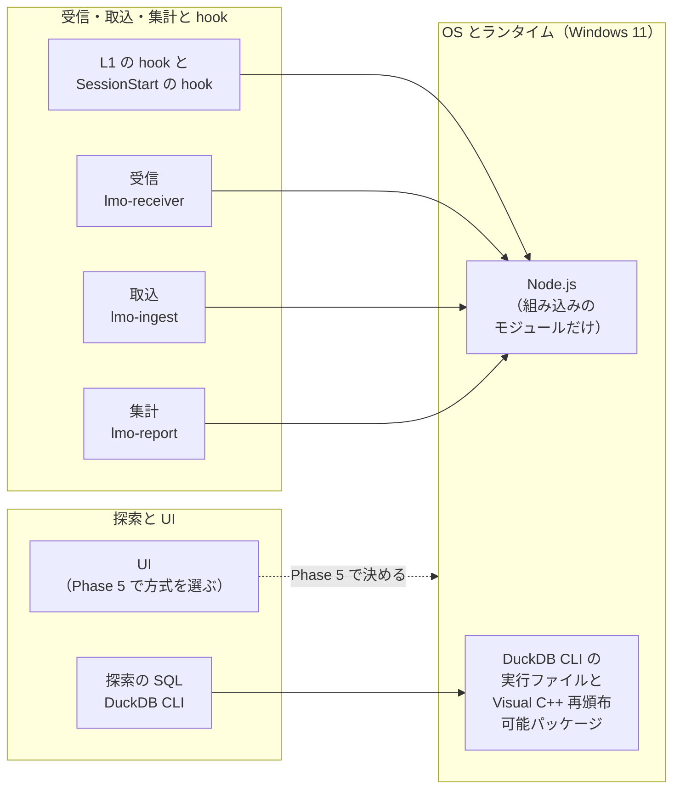
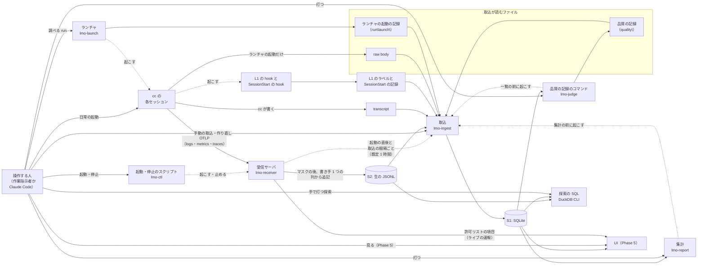
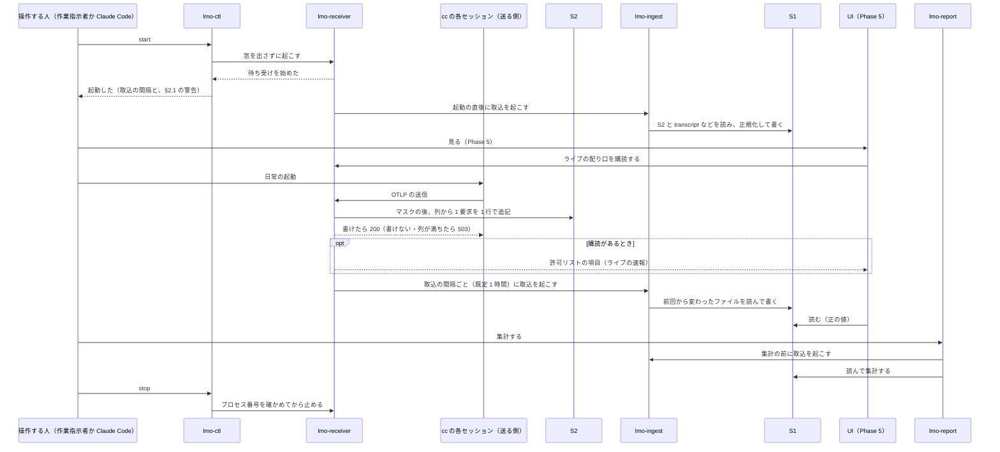

# 設計書 統合（Phase 2 の設計まとめ）

| 項目 | 内容 |
|---|---|
| 位置付け | Phase 2（設計）の統合の設計書で、設計書の承認の入口である（[進め方 P2-1](../00.設計の進め方/計画書.md#sec-p2-1)）。全体像、組の間のつながり、判断の節目の裁定（J-29〜J-34）が全体の構成に及ぼすこと、統合の 12 行（正式リリース物の構成と第二のゴールへの備え）、Phase 3・Phase 7 の結果を待つ 5 つを書く。組の決めごとは写さず、組の設計書の節を指す |
| 状態 | v0.7（2026-10-30）。設計書の承認の前の版である。裁定の反映（[§2](#sec-2)）と組の間のそろえ（[§3.2](#sec-3-2)）は、組の設計書（組 A v0.6、組 B v0.8（定義の別紙 v0.8、対応の別紙 v0.6）、組 C v0.7、組 D v0.7）に入れた。正式リリース物の構成（[進め方 P2-3](../00.設計の進め方/計画書.md#sec-p2-3) の 7）は、設計書の承認のときに J-35 として諮る |
| 想定読者 | 作業指示者（設計書を承認し、J-35 を決める。設計書は [§0](#sec-0)・[§4](#sec-4)・[§6.1](#sec-6-1) で、計画書 v2.5 の案は計画書の v2.5 の小節で判断できるように書いた）、Phase 2 を進める Claude（組の設計書の直し、照合、クロスレビュー）、Phase 3 の PoC の担当。どれも本活動の文脈を持つ前提である |
| 前提 | 計画書 v2.4 が正本（2026-10-26 承認）。今の基線は cc 2.1.314・docs daf68ae（2026-10-30 取得）で（[1-12 §1](../../01.基礎調査/12.cc2.1.314差分の確認/調査報告書.md#sec-1)）、計画書へは v2.5 の案で入れる（[進め方 P2-4](../00.設計の進め方/計画書.md#sec-p2-4)）。判断の節目の 6 件は 2026-10-27 に裁定された。裁定の正本は[判断事項のファイル](../作業指示者裁定待ち事項.md#sec-1) §1 の「裁定」の欄である。行の割り当ては[割り当て表](【別紙】割り当て表.md) v0.8 による |
| 表記 | H-01〜H-35 は組の間の受け渡しの番号（[割り当て表 §2](【別紙】割り当て表.md#sec-2)）、AR・G2・TG・PV・EN などで始まる番号は割り当て表の行（[割り当て表 §1](【別紙】割り当て表.md#sec-1)）、J-29 以降の J-n は判断事項の番号、J-28 までの J-n は [Phase 1 の判断事項](../../01.基礎調査/作業指示者裁定待ち事項.md)の番号である。S1・S2（保存の案）、T1・T2（思考案）、L1・L2（タグ案）は、Phase 1 の Q1 の回答で決まった候補の名前である |
| 関連資料 | [Phase 2 の進め方](../00.設計の進め方/計画書.md)（以下「進め方」）、[割り当て表](【別紙】割り当て表.md)、[【別紙】Phase 3 で確かめる事柄](【別紙】Phase3で確かめる事柄.md)、[【別紙】改訂履歴](【別紙】改訂履歴.md)、[Phase 2 の判断事項のファイル](../作業指示者裁定待ち事項.md)（以下「判断事項」）、[組 A 全体構成](../01.全体構成/設計書.md)（以下「組 A」）、[組 B データモデルと集計](../02.データモデルと集計/設計書.md)（以下「組 B」）、[組 C 作業分類タグ](../03.作業分類タグ/設計書.md)（以下「組 C」）、[組 D 有効化とデータ保全](../04.有効化とデータ保全/設計書.md)（以下「組 D」）、[活動計画書](../../00.活動計画/活動計画書.md)（以下「計画書」）、[基礎調査まとめ](../../01.基礎調査/99.基礎調査まとめ/報告書.md)（以下「まとめ」）、[1-10](../../01.基礎調査/10.cc2.1.310差分の確認/調査報告書.md)、[1-11](../../01.基礎調査/11.cc2.1.311差分の確認/調査報告書.md)、[1-12](../../01.基礎調査/12.cc2.1.314差分の確認/調査報告書.md) |

**読み方**

| 読者 | 読む所 | 読了目安（600〜800 字/分） |
|---|---|---|
| 作業指示者（承認と J-35 を決める） | [§0 要約](#sec-0) → [§4 正式リリース物の構成](#sec-4) → [§6.1 結果を待つ 5 つ](#sec-6-1) → 計画書の[v2.5 の案で承認を受けること](../../00.活動計画/活動計画書.md#sec-approval-v25) | 承認の回の合計で約 19〜26 分（約 15,400 字。本書の 3 か所が約 7,200 字、計画書の小節が約 8,100 字）。J-35 の材料（選択肢の表と推奨の理由）は判断事項の J-35 の行にもあるので、§4 と判断事項の J-35 の行のどちらか一方を読めばよい |
| 作業指示者（全体像を見る） | [§1 全体像](#sec-1) の 3 つの図 | 約 2〜3 分（本文 約 1,700 字と図 3 つ。§1.4 の一覧と §1.5 の表を除く） |
| 作業指示者（記録の中身を引く・自分の操作を見る） | [§1.4](#sec-1-4) の一覧の行から、中身の正本の節へ。[§1.5](#sec-1-5) の操作の表から、正本の節へ | 引く行だけを読む（§1.4 と §1.5 の全体で約 4,800 字・6〜8 分） |
| Phase 2 を進める Claude | 全体。組の直しは [§2](#sec-2) と [§3](#sec-3) | 全体で約 43〜58 分（約 34,700 字。図を除く） |
| Phase 3 の担当 | [§1](#sec-1) → [§6](#sec-6) → 組の設計書。確かめる事柄は [【別紙】Phase 3 で確かめる事柄](【別紙】Phase3で確かめる事柄.md) | §1 と §6 で約 13〜17 分（約 10,300 字と図 3 つ） |

**目次**

| 節 | 中身 |
|---|---|
| [0. 要約](#sec-0) | 目的とスコープ、成功条件と打ち切り条件、決めたこと、承認と保留、決めずに残すこと |
| [1. 全体像](#sec-1) | 部品と依るランタイム、構成とデータの流れ、受信から集計までの順序の図、記録と設定のファイルの一覧、作業指示者の操作 |
| [2. 判断の節目の裁定の反映](#sec-2) | J-29〜J-34 で全体の構成が変わる所と、直す組の節。lmo-ctl の振る舞い |
| [3. 組の間のつながり](#sec-3) | 決めごとの在処と、そろえた組の間の食い違い |
| [4. 正式リリース物の構成（J-35。作業指示者に諮る）](#sec-4) | 保存と思考の選択肢、長所と短所、承認の対象、推奨、決める時期（AR-03・AR-04） |
| [5. 第二のゴールへの備え](#sec-5) | G2-01〜G2-06 の決めたことと、縮退運用で出せる指標 |
| [6. 結果を待つ 5 つと、後の Phase への引き渡し](#sec-6) | 3 区分の表、Phase 3 への引き渡し、後の Phase への申し送り |
| [7. 割り当て表との対応](#sec-7) | 統合の 12 行の状態 |
| [8. 未確認・【推定】に依った決めごと](#sec-8) | 依った事柄、確かめる時期、崩れたときの直し |
| [9. Devil's Advocate](#sec-9) | 主な決めごとへの最強の反論 |

## 0. 要約

本活動の仕組みは、受信サーバ 1 つと、都度起動する取込・集計などのコマンドで作る。受信サーバは常駐させず、作業指示者か Claude Code が起動・停止のスクリプトで起こす（J-29）。統合の 12 行のうち 6 行（第二のゴールへの備えの 6 点）を決め、2 行（正式リリース物の保存と思考）を設計書の承認のときに J-35 として諮り、4 行を Phase 7 の結果で決める。裁定 6 件の全体への反映は [§2](#sec-2) に書き、組の設計書にも入れた。裁定を変える必要は出なかった。

### 0.1 目的とスコープ

- 目的: 作業指示者が、組 A〜D の設計書とあわせて設計を承認できるよう、全体像・組のつながり・統合の決めごとを 1 本にまとめる
- 対象
  - 統合の 12 行（AR-03・AR-04・G2-01〜G2-10。[割り当て表 §1](【別紙】割り当て表.md#sec-1)）
  - 裁定（J-29〜J-34）の全体への反映と、組の間の受け渡しの食い違いのそろえ
  - Phase 3・Phase 7 の結果を待つ 5 つと、Phase 3 への引き渡し（[進め方 §2.1](../00.設計の進め方/計画書.md#sec-2-1) の統合の行）
- 対象外
  - 組の行の決めごと（組の設計書）と、計画書 v2.5 の案（別に作り、設計書と同じ回に承認を受ける）
  - 実装と実機の確認（Phase 3 から）

### 0.2 成功条件と打ち切り条件

- 成功条件
  - 統合の 12 行が、決めた / 作業指示者に諮る / 決めない（理由と時期）のどれかになっている（[§7](#sec-7)）
  - J-35 に、選択肢ごとの長所と短所、承認の対象、推奨、決める時期がそろっている（[§4](#sec-4)）
  - 結果を待つ 5 つに、仮置き、決める時期、決まったときに直す範囲が書かれている（[§6.1](#sec-6-1)）
  - [§3.2](#sec-3-2) のそろえを組の設計書に入れ、照合で受け渡しの食い違いが 0 件になる
- 打ち切り条件: [進め方 §0.3](../00.設計の進め方/計画書.md#sec-0-3) のとおり。本書の執筆では当たらなかった

### 0.3 決めたこと

- 全体の構成: 受信サーバ lmo-receiver を 1 つと、都度起動のコマンド（取込、集計、起動・停止、ランチャ、品質の記録）に分ける（[§1](#sec-1)）
- 受信サーバは常駐させず、起動・停止のスクリプト lmo-ctl で起こす（J-29。[§2.1](#sec-2-1)）
- 受信と保存の流れ（[§1](#sec-1)）
  - 受信サーバは、受けた要求をマスクの後に書き手 1 つの列に並べ、S2 に非同期で追記し、書けてから 200 を返す（[組 A §2.2](../01.全体構成/設計書.md#sec-2-2)）
  - 取込は、受信サーバの起動の直後と取込の間隔ごと（既定 1 時間。5 分〜24 時間で設定できる。[組 D §2.4](../04.有効化とデータ保全/設計書.md#sec-2-4)）、lmo-report と lmo-judge の前、手動で動き、S1 に書く唯一の書き手である
  - UI のライブ表示は、受信サーバが配る許可リストの項目（数・区分・時刻）だけを速報として出す（経路は[組 A §2.7](../01.全体構成/設計書.md#sec-2-7)、規則は[組 D §2.3](../04.有効化とデータ保全/設計書.md#sec-2-3)、形は[組 B §1.12](../02.データモデルと集計/設計書.md#sec-1-12)）。正は S1 である
- 組の間の食い違い 39 件をそろえ、組の設計書に入れた（[§3.2](#sec-3-2)）
  - 正本の組がある 32 件は、その組の値に寄せた。正本の組に値の無かったもの（H-27〜H-31、受信の本文の上限など）は、値を決めてその組に入れた
  - 正本の無い 7 件は、理由を書いて決めた
- 第二のゴールへの備えの 6 点を決めた（[§5](#sec-5)）
  - 縮退運用（transcript の取込だけで回す形）は用意する

### 0.4 承認と保留

| 区分 | 中身 | 扱い |
|---|---|---|
| 承認していただくもの | 本書と組 A〜D の設計書（別紙を含む）、計画書 v2.5 の案（承認の対象は[v2.5 の案で承認を受けること](../../00.活動計画/活動計画書.md#sec-approval-v25)の小節） | 設計書の承認の回にまとめて承認していただく |
| 作業指示者に諮る事項 | J-35 正式リリース物の構成（AR-03・AR-04） | 推奨は、保存は S1 だけ（S2 は一時置き場。【推定】と、正式リリース物で S1 のバックアップを決めることに依る。[§8](#sec-8) の 4）、思考は T1 で設計し、T2 を足すかは V-2b の後に決める。材料は [§4](#sec-4) |
| 承認済み | 進め方 P2-1〜P2-4（2026-10-26）、判断の節目の J-29〜J-34（2026-10-27） | 裁定のとおりに組の設計書に入れた（[§2](#sec-2)） |
| 保留（結果を待つ） | Phase 3 の結果で決める 1 件、Phase 7 の結果で決める 4 件 | 仮置きと時期を承認していただく（[§6.1](#sec-6-1)） |
| 先送り | [計画書の承認と保留](../../00.活動計画/活動計画書.md#sec-approval-v24)の先送りの行と、v2.5 の案で足した先送りの行（職場の受信サーバの起動の仕方と、Phase 7 の完了条件の「操作を増やさずに」の扱い。J-29 で決めないもの） | 本書では変えない。v2.5 の案の行は[v2.5 の小節](../../00.活動計画/活動計画書.md#sec-approval-v25)の表の最後の行にある |

J-35 として[判断事項のファイル](../作業指示者裁定待ち事項.md#sec-1)に載せた。

### 0.5 決めずに残すこと

| 事項 | 理由 | 時期 |
|---|---|---|
| 結果を待つ 5 つ（TG-09、G2-07〜G2-10） | 計画書が Phase 3・Phase 7 の結果で決めるとしている | [§6.1](#sec-6-1) の表 |
| 正式リリース物の保持の日数（PV-01 の一部） | 保存の構成（J-35）で、消してよいものが変わる | J-35 の後。Claude が組 D §2.1 に足し、判断事項の報告で確かめていただく（[§4](#sec-4) の決めないもの） |
| 正式リリース物の S1 のバックアップの形（誰が、いつ、どこへ写すか） | 保持の日数と同じく、保存の構成（J-35）で写すものが変わる | J-35 の後（[§4](#sec-4) の決めないもの） |
| T2 を足すか（J-35 で思考案を「T1 で設計し、T2 は V-2b の後に決める」にした場合。AR-04 の残り） | 応答のボディに usage が入るか（V-2b）で、T2 の要否が変わる | V-2b の結果が出たとき。Claude が材料を足して作業指示者に諮る（[§4](#sec-4) の決めないもの） |
| 使用量の上限の消費を Mod で記録する表 `plan_usage_snapshot` を、日常に埋めるか（H-29） | 記録の中身が docs だけによる（[組 B §7](../02.データモデルと集計/設計書.md#sec-7) の 6）ので、Phase 3 で確かめてから決める | Phase 4 に進むかの判断のとき（[§3.2](#sec-3-2) の 24） |
| 品質の 3 段階の判定（J-33）の境の文 | 判定の基準なので作業指示者が決める。決める時期は作業指示者の決め（2026-10-30） | Phase 4 の日常の判定を始める前（書く所は[組 B §2.3](../02.データモデルと集計/設計書.md#sec-2-3)） |

## 1. 全体像

受信サーバは cc の送信をマスクし（規則は[組 D §2.3](../04.有効化とデータ保全/設計書.md#sec-2-3)）、書き手 1 つの列から生の JSONL（S2）に足す。SQLite（S1）には取込だけが書く。集計は S1 を読む。UI は S1 を主に読み、S2 は直接読まない（[組 A §2.3](../01.全体構成/設計書.md#sec-2-3) の表・[§2.5](../01.全体構成/設計書.md#sec-2-5)）。UI のライブ表示は、受信サーバが配る許可リストの項目（数・区分・時刻）だけを速報として受ける（[組 A §2.7](../01.全体構成/設計書.md#sec-2-7)）。プロセスの分け方の理由は[組 A §2.1](../01.全体構成/設計書.md#sec-2-1) に、名前の一覧は[組 A §7.1](../01.全体構成/設計書.md#sec-7-1) の H-05 に、記録と設定のファイルの一覧は [§1.4](#sec-1-4) に、作業指示者の操作は [§1.5](#sec-1-5) にある。

### 1.1 部品と依るランタイム

図 1 は、本環境の端末で動く部品と、それぞれが依るランタイムを示す（点線はまだ決めていない依存）。受信・取込・集計と hook は Node.js の組み込みのモジュールだけに依り、DuckDB CLI は探索の側に入る。UI の側に入るのは、Phase 5 で UI の読み先に DuckDB のファイルを足した場合だけである（[組 A §3.3](../01.全体構成/設計書.md#sec-3-3)・[§2.5](../01.全体構成/設計書.md#sec-2-5)）。起動・停止・ランチャ・品質の記録のコマンドも Node.js に依る（図 2 にある）。UI の依存は Phase 5 で画面案とあわせて決める。部品ごとの書く所と読む所は[組 A §1](../01.全体構成/設計書.md#sec-1) の表にある。

### 1.2 構成とデータの流れ

図 2 は、cc の OTel の送信が受信サーバと S2 を通って S1 に入る流れ、受信サーバから UI へのライブの速報の経路、S2・transcript・OTel の外の記録（[組 A §1](../01.全体構成/設計書.md#sec-1) の表）が取込の入り口に集まる形を示す。実線は操作とデータの流れ、点線は、プロセスが別のプロセスを起こす・止める所である（lmo-report は集計の前に、lmo-judge は判定する作業の一覧の前に、取込を子プロセスで起こす。[組 A §2.8](../01.全体構成/設計書.md#sec-2-8)）。操作する人は、cc・lmo-ctl・ランチャ・lmo-report・lmo-judge・手動の取込を起こし、DuckDB CLI で探索し、UI を見る。打つ形と引数は [§1.5](#sec-1-5) の表と[組 A §2.10](../01.全体構成/設計書.md#sec-2-10) にある。Claude Code が操作する人になるときも、その Claude Code は cc のセッションとして OTel を送る。ほかのプロセスは、図の点線の元が起こす。UI は S1 を主に読み、受信サーバからライブの速報（許可リストの項目）を受ける。ライブで見えるのは、API 呼び出し 1 件ごとのモデル・effort・トークン 4 種・環境ラベルなど（[組 B §1.12](../02.データモデルと集計/設計書.md#sec-1-12)）で、作業分類と思考トークンは取込の後に S1 で見る。画面は Phase 5 から作る（Phase 3 は Claude の試しの購読だけ）。UI は S2 を直接読まず、S2 にしか無い情報は、取込で DB（S1 を第一とする）に入れてから読む。DuckDB CLI は作業指示者が手で打つ探索で、`.duckdb` のファイルを持たずにメモリ上で S1 と S2 を読み（[組 A §2.3](../01.全体構成/設計書.md#sec-2-3)）、UI は DuckDB CLI を使わない。S1 と別の DB（DuckDB のファイルなど）を持ち、UI がそれを読むかは Phase 5 で決め、決まったら図に足す（[組 A §2.5](../01.全体構成/設計書.md#sec-2-5)）。UI と DuckDB CLI は、どちらにも書かない。計測用のセッション（[組 D §1.4](../04.有効化とデータ保全/設計書.md#sec-1-4)）は別の受信サーバとデータの根で動き、図に描かない。図にある記録と、設定のファイル・単価表などの図に無いファイルの中身は、[§1.4](#sec-1-4) の一覧から引ける。

### 1.3 受信から集計までの順序

図 3 は、受信サーバを起動してから止めるまでに、受信・取込・ライブ表示・集計がどの順で動くかを示す。200 は S2 に書けてから返し、ライブの速報はその後に配る。

- 取込は、元の表に行が入ったセッションについて、`usage_record` と派生の列を作り直す（[組 B §1.1](../02.データモデルと集計/設計書.md#sec-1-1)）
- L1 の hook は `UserPromptSubmit` のときにラベルを書き、取込は S2 と同じ回にそれを読む（[組 C §4.1](../03.作業分類タグ/設計書.md#sec-4-1) の H-18、[組 A §2.8](../01.全体構成/設計書.md#sec-2-8)）
- 受信サーバを止めている間に使った cc のセッションは、次の取込で transcript から数える（[§2.1](#sec-2-1)）。cc の操作が止まらないことは Phase 3 で確かめる（[組 D §1.6](../04.有効化とデータ保全/設計書.md#sec-1-6)）

### 1.4 記録と設定のファイルの一覧

プロセスと hook が書き、読むファイルと、cc が読む設定の入口である。置き場所は、repo・計測のデータの根・cc の設定フォルダ・scratchpad と断った行のほかは、データの根（[組 A §4](../01.全体構成/設計書.md#sec-4) のフォルダの構成）の下のフォルダである。ファイルの名前と中身の形は「中身の正本」の節にある。

- 「機微」は、本文・識別子・利用者の付けた名前・利用統計の実数（件数・大きさ・使用率。報告書での扱いは[活動の CLAUDE.md](../../../CLAUDE.md) の作業時の制約）が入りうるかで、扱いは正本の節にある。`session_id` などの識別子はほとんどの行にあるので、列には行に固有のもの（`cmd`・`cwd`・`work_ref`・`note`・ファイルのパスなど）を書く
- 「保持と消し方」は本活動の間の扱いで、正本は[組 D §2.1](../04.有効化とデータ保全/設計書.md#sec-2-1)（バックアップの対象かを含む）と [§2.2](../04.有効化とデータ保全/設計書.md#sec-2-2)（transcript）である。「消さない」は、本活動の終わりか不要になったときに、Claude が作る一覧を作業指示者が確かめてから消す

| 記録 | 置き場所 | 書き手と書く時期 | 読み手 | 中身の正本 | 機微 | 保持と消し方 |
|---|---|---|---|---|---|---|
| S2（生の JSONL） | `raw\` | lmo-receiver。要求ごと | lmo-ingest、DuckDB CLI（探索） | [組 A §7.1](../01.全体構成/設計書.md#sec-7-1) の H-06 | 含む（本文系。識別属性はハッシュに替えた後。[組 D §2.3](../04.有効化とデータ保全/設計書.md#sec-2-3) のマスクの表） | 消さない |
| S1（SQLite） | `db\` | lmo-ingest。取込ごと | lmo-report、lmo-judge、UI、DuckDB CLI（探索） | [組 B §1.1](../02.データモデルと集計/設計書.md#sec-1-1)、[定義の別紙 §1](../02.データモデルと集計/【別紙】スキーマと指標の定義.md#sec-1) | 含む（S2 と同じ。span の event など、S1 に入れない S2 の中身（組 B §1.1）は除く。下の `cmd`・`cwd`・`work_ref`・`note` も入る）。利用統計 | 消さない。`state\` と一緒にバックアップの対象 |
| 受信サーバの動作の記録 | `run\receiver\` | lmo-receiver。組 A §2.9 の `kind` ごとに決めたとき | lmo-ctl の `start`、Phase 3 の確かめ | [組 A §2.9](../01.全体構成/設計書.md#sec-2-9)（H-34） | 利用統計（`hourly` の数） | 消さない |
| 受信サーバのプロセス番号 | `run\lmo-receiver.pid` | lmo-receiver。待ち受けを始めたとき | lmo-ctl | [組 A §2.2](../01.全体構成/設計書.md#sec-2-2) の起動と停止 | 含まない | 受信サーバが動く間だけ。lmo-ctl が消す（[§2.1](#sec-2-1)） |
| 取込の記録 | `run\ingest\` | lmo-ingest。取込ごと | lmo-ctl の `start`、lmo-report、lmo-judge、Phase 3 の確かめ | [組 D §2.4](../04.有効化とデータ保全/設計書.md#sec-2-4) の H-12 | ファイルのパス。利用統計（`store_bytes`） | 消さない |
| 取込の状態（読んだ位置、ロック、計測用のセッションを除く一覧） | `state\` | lmo-ingest。取込ごと | lmo-ingest | 読んだ位置とロックは[組 A §2.8](../01.全体構成/設計書.md#sec-2-8)、除く一覧は[組 D §2.4](../04.有効化とデータ保全/設計書.md#sec-2-4) | ファイルのパス | 消さない（ロックは取込の間だけ）。S1 と一緒にバックアップの対象 |
| 設定のファイル | `config\lmo-settings.json` | 作業指示者か Claude が手で直す。キーは `l2_enabled`・`ingest_interval_min` で、値を変えたら `stop` と `start`（直し方は [§1.5](#sec-1-5)） | lmo-receiver、lmo-ingest、lmo-ctl | [組 C §4.1](../03.作業分類タグ/設計書.md#sec-4-1) の H-31（取込の間隔のキーは[組 D §2.4](../04.有効化とデータ保全/設計書.md#sec-2-4)） | 含まない | 消さない |
| ハッシュの鍵 | `config\` の下の鍵のファイル | lmo-receiver。ファイルが無いときの起動 | lmo-receiver | [組 D §2.3](../04.有効化とデータ保全/設計書.md#sec-2-3) の鍵 | 含む（鍵） | 消さない |
| L1 のラベル | `labels\` | L1 の hook。プロンプトごと | lmo-ingest | [組 C §4.1](../03.作業分類タグ/設計書.md#sec-4-1) の H-18 | `cmd`（[組 C §1.5](../03.作業分類タグ/設計書.md#sec-1-5) の `cmd` の出し方） | 消さない |
| `SessionStart` の記録 | `session-start\` | `SessionStart` の hook。セッションの始まり | lmo-ingest | [組 C §4.1](../03.作業分類タグ/設計書.md#sec-4-1) の H-28 | `cwd`（[H-28 の `cwd` の扱い](../03.作業分類タグ/設計書.md#sec-4-1)） | 消さない |
| 品質の記録 | `quality\` | lmo-judge（一覧の前に取込を起こす。H-30）。作業指示者が判定したとき | lmo-ingest | 列と鍵は[定義の別紙 §7](../02.データモデルと集計/【別紙】スキーマと指標の定義.md#sec-7)（H-35）、意味は[組 B §2.3](../02.データモデルと集計/設計書.md#sec-2-3)、入れ方は[組 A §7.1](../01.全体構成/設計書.md#sec-7-1) の H-30 | `work_ref`・`note`（手で書く値） | 消さない |
| raw body | `api-bodies\` | cc。ランチャで起動したセッションだけ | lmo-ingest | [組 D §1.3](../04.有効化とデータ保全/設計書.md#sec-1-3)（H-17） | 含む（会話の全体。マスクを通らない） | 突合の後に消してよい |
| ランチャの起動の記録 | `run\launch\` | lmo-launch。起動ごと | lmo-ingest | [組 D §1.3](../04.有効化とデータ保全/設計書.md#sec-1-3) の起動の記録 | 識別子だけ | 消さない |
| 計測用のセッションの記録 | 計測のデータの根の `run\measure\` | 計測の手順（Claude）。cc を起こす前 | lmo-ingest（日常と計測用の取込） | [組 D §1.4](../04.有効化とデータ保全/設計書.md#sec-1-4) | 識別子だけ | 計測のデータの根ごと消す（消す前の確かめは組 D §2.1） |
| Mod の記録 | 計測のデータの根の下（名前は Phase 3 の試作で決める） | L1 の Mod 版と `$.session.usage()` の Mod。計測用のセッションだけ | 計測用の取込（日常の S1 には入らない） | [組 C §4.1](../03.作業分類タグ/設計書.md#sec-4-1) の H-29 | 利用統計（上限の使用率） | 計測のデータの根ごと消す（結果を Phase 3 の報告書に書いた後。組 D §2.1） |
| transcript とサブエージェントの `meta.json` | cc の設定フォルダの `projects` の下 | cc | lmo-ingest（`meta.json` は `toolUseId` だけ） | 読み方は[組 D §2.4](../04.有効化とデータ保全/設計書.md#sec-2-4)、`meta.json` から作る行は[定義の別紙 §1.1](../02.データモデルと集計/【別紙】スキーマと指標の定義.md#sec-1-1) の `subagent_invocation` | 含む（会話の全体。取込は usage と鍵だけを読む）。`meta.json` の中身は未確認 | cc が 30 日で消す（[組 D §2.2](../04.有効化とデータ保全/設計書.md#sec-2-2)） |
| hook のスクリプトの写し | `hooks\` | Claude。hook を直したとき | cc が起こす L1 の hook と `SessionStart` の hook | [組 A §7.1](../01.全体構成/設計書.md#sec-7-1) の H-27 | 含まない | 消さない（ユーザ settings の `hooks` を外した後に消す） |
| 単価表 | repo の `app/config/price-tables/`、職場の組はデータの根の `config\price-tables\` | Claude と作業指示者（組ごとに[定義の別紙 §1.1](../02.データモデルと集計/【別紙】スキーマと指標の定義.md#sec-1-1) の表） | lmo-ingest | [組 B §6.1](../02.データモデルと集計/設計書.md#sec-6-1) の H-23 | 職場の組（H-23） | repo で持つ。職場の組は消さない |
| ほかのデータの表のファイル | repo の `app/config/`、端末ごとのもの（`env-config.json`・`model-alias.json`）はデータの根の `config\` | Claude と作業指示者（ファイルごとに[定義の別紙 §1.1](../02.データモデルと集計/【別紙】スキーマと指標の定義.md#sec-1-1) の表） | lmo-ingest | [定義の別紙 §1.1](../02.データモデルと集計/【別紙】スキーマと指標の定義.md#sec-1-1) のデータの表のファイル | データの根の 2 つ（職場の値） | repo で持つ。データの根の 2 つは消さない |
| 分類体系のデータ `taxonomy.json` | repo の `app/config/taxonomy/`（写しはデータの根の `hooks\`） | Claude。区分か規則を直したとき | L1 の hook（写し）、L1 の Mod 版、lmo-ingest（repo の元。読めなければ取込の失敗） | [組 C §1.1](../03.作業分類タグ/設計書.md#sec-1-1) の `taxonomy.json` の形 | 含まない | repo で持つ。写しは上の hook の写しと同じ |
| ライブの速報 | 保存しない | lmo-receiver。購読があるとき、要求ごと | UI | 経路は[組 A §2.7](../01.全体構成/設計書.md#sec-2-7)、形は[組 B §1.12](../02.データモデルと集計/設計書.md#sec-1-12)、規則は[組 D §2.3](../04.有効化とデータ保全/設計書.md#sec-2-3) の許可リスト | 含まない（許可リストで限る。`model` のゲートウェイの別名は[組 D §6](../04.有効化とデータ保全/設計書.md#sec-6) の 16） | 保存しない |
| ユーザ settings の `env`・`hooks` | cc の設定フォルダのユーザ settings | 作業指示者（手順は Claude が書く）。Phase 3 の着手時の設定の手順のとき | cc（日常のセッション） | [組 D §1.2](../04.有効化とデータ保全/設計書.md#sec-1-2)・[§1.7](../04.有効化とデータ保全/設計書.md#sec-1-7)、[組 C §2.2](../03.作業分類タグ/設計書.md#sec-2-2) | 値（`hooks` の `args` の絶対パスなど。報告書にはキー名までを書く） | 作業指示者が外す（組 D §1.7 の戻し方） |
| 計測用の settings ファイル | scratchpad | Claude。計測の手順を書くとき | 計測用のセッションの cc | [組 D §1.4](../04.有効化とデータ保全/設計書.md#sec-1-4) | plugin の名前 | 決めない（repo に入れない） |

S1 の行が元のファイルを指す列（`s2_ref`・`source_ref`）の形は[定義の別紙 §1.7](../02.データモデルと集計/【別紙】スキーマと指標の定義.md#sec-1-7) にある。

### 1.5 作業指示者の操作

作業指示者が打つもの・直すもの・見るものの一覧である。頼まれた Claude Code も同じ形で打つ。コマンドは `node <活動フォルダ>\app\bin\<名前>.mjs <引数>` の形で打ち（[組 A §7.1](../01.全体構成/設計書.md#sec-7-1) の H-05）、表の「打つ形」には名前と引数だけを書く。引数と終了コードの正本は[組 A §2.10](../01.全体構成/設計書.md#sec-2-10) である。

| 操作 | 打つ形・直す所 | いつ | 見るもの（表示・出力） | 詳しくは |
|---|---|---|---|---|
| 受信サーバの起動 | `lmo-ctl start` | cc を使う前。設定のファイルを直した後 | 表示（プロセス番号、待ち受けのアドレスと番号、取込の間隔と出どころ）と警告 | [§2.1](#sec-2-1) |
| 受信サーバの停止 | `lmo-ctl stop` | cc を使い終えた後。設定のファイルを直すときと、バックアップの前 | 止めたプロセス番号か、動いていないことの表示 | [§2.1](#sec-2-1) |
| 応えない受信サーバを止める | OS の道具でそのプロセスを止め、`lmo-ctl start` を打つ | `start` か `stop` が、応えない受信サーバのプロセス番号を表示したとき | 表示されたプロセス番号 | [§2.1](#sec-2-1) の応えない受信サーバの止め方 |
| 手動の取込 | `lmo-ingest`（引数なし） | すぐに S1 に入れたいとき（ふだんは受信サーバと lmo-report・lmo-judge が起こす） | 終了コードと標準エラー | [組 A §2.8](../01.全体構成/設計書.md#sec-2-8) |
| 作り直し | `lmo-ingest --rebuild` | 単価表・データの表・取込の規則を直した後と、S1 のファイルを失ったとき（先に退けるファイルは組 A §2.8 の異常のとき） | 終了コードと標準エラー | [組 A §2.8](../01.全体構成/設計書.md#sec-2-8) の通常と作り直し・異常のとき |
| 集計 | `lmo-report`（`--since <YYYY-MM-DD>`・`--until <YYYY-MM-DD>` は任意） | 集計を見たいとき | 集計の表（時刻は UTC）と警告 | [組 A §2.3](../01.全体構成/設計書.md#sec-2-3) |
| 判定 | `lmo-judge`（引数は Phase 4 の実装で決める） | 比べたい作業を終えた後（Phase 4 から。Phase 3 の間は lmo-report のセッションの一覧で選ぶ） | 判定する作業の一覧（時刻は UTC）と警告 | [組 A §7.1](../01.全体構成/設計書.md#sec-7-1) の H-30、意味は[組 B §2.3](../02.データモデルと集計/設計書.md#sec-2-3) |
| ランチャでの起動 | `lmo-launch <cc の引数>` | 思考トークンを raw body で補うセッション（T1 と T2 を比べる run） | cc の画面と終了コード | [組 D §1.3](../04.有効化とデータ保全/設計書.md#sec-1-3) |
| 探索 | DuckDB CLI で S1 と S2 を SQL で読む | 任意 | 問い合わせの結果 | [組 A §2.3](../01.全体構成/設計書.md#sec-2-3) |
| 設定のファイルの直し | `<データの根>\config\lmo-settings.json` のキー `l2_enabled`（真偽値）・`ingest_interval_min`（分の整数）。直したら `stop` の後に `start` | L2 を切り替えるとき、取込の間隔を変えるとき | `start` の表示（取込の間隔と出どころ）と警告の 3〜6 | [組 C §4.1](../03.作業分類タグ/設計書.md#sec-4-1) の H-31、[組 D §2.4](../04.有効化とデータ保全/設計書.md#sec-2-4) |
| ユーザ settings の設定 | ユーザ settings の `env` と `hooks`（JSON の断片は Claude が書く手順にある） | Phase 3 の着手時（`env` を先に設定し、hook なしの基準を取ってから `hooks`。順序は組 D §1.7）。不具合のときは外す | Claude の確かめの結果 | [組 D §1.7](../04.有効化とデータ保全/設計書.md#sec-1-7) |
| バックアップ（任意） | `db\` と `state\` ほかの対象を外部の記憶装置に写す（写す前の確かめと順は組 D §2.1） | Phase の区切り | — | [組 D §2.1](../04.有効化とデータ保全/設計書.md#sec-2-1) |
| 残ったロックの削除 | `<データの根>\state\ingest.lock` を消す | 取込を待つ表示の、ロックを取った時刻が古いまま続くとき | 待つ表示（ロックの契機と取った時刻） | [組 A §2.8](../01.全体構成/設計書.md#sec-2-8) のロック |
| 画面を見る | UI（方式は Phase 5 で選ぶ） | Phase 5 から | ライブの速報と S1 の値 | [組 A §2.5](../01.全体構成/設計書.md#sec-2-5)・[§2.7](../01.全体構成/設計書.md#sec-2-7) |

## 2. 判断の節目の裁定の反映

6 件の裁定を、全体の構成で変わる所に分けて書く。組の設計書には、表の「入れた組の節」に入れ、判断事項の J へのリンクを足した。

| J | 裁定（正本は[判断事項 §1](../作業指示者裁定待ち事項.md#sec-1)） | 全体の構成で変わること | 入れた組の節 |
|---|---|---|---|
| J-29 | 案 1「手動」。起動・停止のスクリプトを作り、手順書は作らない | 受信サーバを常駐させない。起動・停止のスクリプト lmo-ctl を足す（[§2.1](#sec-2-1)） | 組 A §0・§1・§2.1・§5.2・§7.1、組 D §0.1・§0.3〜§0.5・§1.2・§1.4・§1.5・§2.2・§2.4・§3.1・§5〜§7 |
| J-30 | 案 1「圧縮しない」 | S2 の閉じた日のファイルと raw body を圧縮しない。見直しの条件（データの根の 30 日分がディスクの空きの 1 割を超える見込み。[組 D §3.2](../04.有効化とデータ保全/設計書.md#sec-3-2)）は残す | 組 D §0.4・§3.2・§5 |
| J-31 | 承認（推奨どおり） | 内容を記録する変数のうち 3 つをユーザ settings に、2 つをランチャに置く。正式リリース物は 5 つとも無効（[組 D §3.3](../04.有効化とデータ保全/設計書.md#sec-3-3)） | 組 D §0.3・§0.4・§1.1〜§1.3・§3.3・§4.1・§5・§6、組 C §1.7・§4.2 |
| J-32 | 案 A。作業指示者の注記: 「モデル選定原則」の考え方と check-model の判定基準は仮説を元に作ったもので、本仕組みの完成後に定量評価で見直す。絶対のものとして扱わない | 区分と還流先の行の対応を、還流先が改訂されたときにも見直す（[§2.2](#sec-2-2)） | 組 C §0.4・§1.1・§3・§4.1・§6 |
| J-33 | A「作業指示者の判定」だけ | 手戻りの代理指標（B）を採らないので、修正依頼の区分や印は作らない。表 `quality_judgement` は残し、作業指示者の判定だけを入れる。入れ方を H-30 として決めた（[§3.2](#sec-3-2) の 25）。判定は後から足せ、判定の無い作業は分母から外して件数を添え、判定し直しは最新の行を使い、判定する作業は lmo-judge が S1 から並べるセッションから選ぶ。品質は作業分類 × 移譲の区分で出し、区分は範囲の `usage_record` から規則で導いて、サブエージェントへの移譲と、主の会話のモデルを Sonnet の系統に替えた形を分けて数える（意味と区分の規則は[組 B §2.3](../02.データモデルと集計/設計書.md#sec-2-3)、列と鍵は[定義の別紙 §7](../02.データモデルと集計/【別紙】スキーマと指標の定義.md#sec-7)、入れ方は[組 A §7.1](../01.全体構成/設計書.md#sec-7-1) の H-30） | [組 A §7.1](../01.全体構成/設計書.md#sec-7-1)、[組 B §0](../02.データモデルと集計/設計書.md#sec-0)・[§2.3](../02.データモデルと集計/設計書.md#sec-2-3)・[§5](../02.データモデルと集計/設計書.md#sec-5)・[§6.2](../02.データモデルと集計/設計書.md#sec-6-2)・[§8](../02.データモデルと集計/設計書.md#sec-8)、[定義の別紙 §1.1](../02.データモデルと集計/【別紙】スキーマと指標の定義.md#sec-1-1)・[§3](../02.データモデルと集計/【別紙】スキーマと指標の定義.md#sec-3)・[§7](../02.データモデルと集計/【別紙】スキーマと指標の定義.md#sec-7)、[対応の別紙](../02.データモデルと集計/【別紙】割り当て表との対応.md)、[組 D §3.3](../04.有効化とデータ保全/設計書.md#sec-3-3)・[§6](../04.有効化とデータ保全/設計書.md#sec-6) |
| J-34 | 案 1（Node.js、npm パッケージ 0）。npm パッケージが 1 以上になったら、中身も踏まえて実装方針を変えるかを検討する | 受信・保存・取込・集計を npm パッケージ 0 で書く。1 以上になる見込みが出たら、その時点で作業指示者に諮る（[§2.3](#sec-2-3)） | 組 A §0.2・§3・§3.3・§8・§9 |

### 2.1 J-29: 受信サーバを常駐させない

**決めたこと**

- 起動・停止のスクリプトは、Node.js の 1 本（`app/bin/lmo-ctl.mjs`）にする
  - 作業指示者も Claude Code も、`lmo-ctl` の `start` と `stop` を同じ形で打つ（打つ形は、`app/bin/` の絶対パスを使う[組 A §7.1](../01.全体構成/設計書.md#sec-7-1) の H-05。引数と終了コードは[組 A §2.10](../01.全体構成/設計書.md#sec-2-10)。作業指示者の操作の一覧は [§1.5](#sec-1-5)）
  - 引数が無いときは、使い方を表示する。手順書は作らない（J-29 の裁定）
  - 受信サーバが動いているかだけを見る引数は持たない。`start` が兼ねる（下の `start` の 2）
- lmo-receiver は、次の 2 つの振る舞いを持つ（[組 A §2.1](../01.全体構成/設計書.md#sec-2-1)・[§2.2](../01.全体構成/設計書.md#sec-2-2)）
  - 待ち受けの番号がすでに使われていたら、記録して終える（[組 D §1.5](../04.有効化とデータ保全/設計書.md#sec-1-5)）
  - 起動の直後と取込の間隔（既定 1 時間）ごとに、取込を子プロセスで起こす（[組 D §2.4](../04.有効化とデータ保全/設計書.md#sec-2-4) の頻度と間隔の設定）
- transcript の保持の決めごと（`cleanupPeriodDays` を延ばさない。[組 D §2.2](../04.有効化とデータ保全/設計書.md#sec-2-2)）は保つ
  - 受信サーバを止めていた間のセッションは、次に起動したときの取込で transcript から数えて補う（[§3.2](#sec-3-2) の 20）

**`start` の振る舞い**（ここの「番号のファイル」は `run\lmo-receiver.pid`、「動作の記録」は `run\receiver\`。どちらも[組 A §2.2](../01.全体構成/設計書.md#sec-2-2)・[§2.9](../01.全体構成/設計書.md#sec-2-9)。動作の記録と取込の記録は日別のファイルなので、読む行は最新の日付のファイルから遡って探す）

| 順 | 動き |
|---|---|
| 1 | 取込の記録（[組 D §2.4](../04.有効化とデータ保全/設計書.md#sec-2-4) の H-12）の最後の行と、動作の記録の最後の `hourly` の行を読む（下の警告の 1・2・6・9 に使う） |
| 2 | 待ち受けの番号に要求を 1 つ送り、応答を待つ（待つ上限は 5 と同じ 10 秒）。応答のヘッダのプロセス番号が番号のファイルの番号と同じなら、受信サーバはすでに動いているので起こさない。そのプロセス番号と、その受信サーバが使っている取込の間隔（動作の記録の、そのプロセス番号の起動の行）を表示し、警告を出して成功で終える |
| 3 | 次のときは、起こさずに失敗で終える。 ・応答はあるが 2 に当たらない（ヘッダが無い、ヘッダのプロセス番号が番号のファイルと違う、番号のファイルが無い）: 待ち受けの番号を使っている相手（ヘッダがあればそのプロセス番号）を表示する ・接続できたが、上限の内に応答が来ない（応えない受信サーバ）: 番号のファイルを残し、そのファイルのプロセス番号（ファイルがあれば）と、応えないことを表示する。止め方は下の「応えない受信サーバの止め方」 |
| 4 | 接続を断られたら（待ち受けている受信サーバが無い）、残っている番号のファイルを古いものとして消し、lmo-receiver を窓を出さずに子プロセスとして起こして、cc や起こしたシェルと独立に動かす（[§8](#sec-8) の 1） |
| 5 | 0.5 秒ごとに待ち受けの番号に要求を送り、応答のヘッダのプロセス番号が起こした子の番号と同じになったら、起動したとみなす。待つ上限は 10 秒【推定】（[§8](#sec-8) の 7） |
| 6 | 起動したら、プロセス番号、待ち受けのアドレスと番号、使う取込の間隔とその出どころを表示し、警告を出して成功で終える（表示の文言は Phase 3 で決める）。間隔は受信サーバと同じ部品で求める（[組 A §7.2](../01.全体構成/設計書.md#sec-7-2) の H-11） |

上限までに起動したとみなせないときは、次のとおりに理由を読んで表示し、失敗で終える。

| 子の様子 | 表示する理由 |
|---|---|
| 終わっていて、動作の記録の子のプロセス番号の最後の行が、待ち受けの番号の衝突か鍵が読めない行（行の種類は組 A §2.9） | そのこと。鍵が読めないときは、鍵のファイルをバックアップから戻すことを添える（[組 D §2.3](../04.有効化とデータ保全/設計書.md#sec-2-3)） |
| 終わっていて、動作の記録の子のプロセス番号の最後の行が `host_not_loopback`（`LMO_OTLP_HOST` がループバックのアドレスでない） | そのことと、変数の値（行の `host`）。変数を外すか、ループバックのアドレスにしてから `start` を打ち直すことを添える（[組 A §4](../01.全体構成/設計書.md#sec-4)） |
| 終わっていて、動作の記録に子の行が無い | 起こした受信サーバがすぐ落ちたこと（子の終了コードを添える） |
| 動いたまま、上限を過ぎた | 待ち受けを始められなかったこと。子は止める |

**応えない受信サーバの止め方**（`start` の 3 か `stop` が、応えないことを表示したとき。作業指示者か Claude Code が行う）: lmo-ctl はそのプロセスを止めない（下の理由）。番号のファイルが無かったときは、待ち受けの番号を使うプロセスの番号を OS の道具（例 `netstat -ano`）で探す。その番号のプロセスが lmo-receiver（`app\bin\lmo-receiver.mjs` を動かす node）であることを、OS の道具（タスク マネージャーの詳細のコマンド ラインなど）で確かめてから、そのプロセスを止める（例 `taskkill /PID <番号> /F`）。続けて `start` を打つ。待ち受けの番号は接続を断るので、`start` は番号のファイルを古いものとして消して起こす（`start` の 4）。

**警告**（`start` は、起こしたときも、すでに動いていたときも出す。標準エラーに出し、警告があっても成功で終える）

| # | 警告する事柄 | 読む所 |
|---|---|---|
| 1 | 順の 1 で読んだ最後の取込の時刻から 14 日を過ぎている（役目と日数は[組 D §2.2](../04.有効化とデータ保全/設計書.md#sec-2-2)） | 取込の記録の最後の行 |
| 2 | 最後の取込が失敗した（`status` が `error`。失敗の扱いは[組 A §2.8](../01.全体構成/設計書.md#sec-2-8) の異常のとき） | 同上 |
| 3 | 取込の間隔の設定の値を既定に戻した（[組 D §2.4](../04.有効化とデータ保全/設計書.md#sec-2-4)） | 起こしたときは lmo-ctl が同じ部品で求めた結果、すでに動いていたときはその受信サーバの起動の行 |
| 4 | 設定のファイルを使えなかった（[組 C §4.1](../03.作業分類タグ/設計書.md#sec-4-1) の H-31 の壊れたとき） | 同上 |
| 5 | すでに動いていた受信サーバの取込の間隔か `l2_enabled` が、今の設定から求めた値と違う（起動し直すまで旧い値で動く。H-31 の起動し直しを忘れた間） | その受信サーバの起動の行と、lmo-ctl が同じ部品で求めた値 |
| 6 | 最後の取込が設定のファイルを使えなかった（`settings_issue` がある。H-31 の壊れたとき） | 取込の記録の最後の行 |
| 7 | 受信サーバが鍵を失った後に起動した（起動の行の `key_created` が真で、データの根の `raw\` の下に、その起動の時刻より前に書かれた S2 のファイルがある。直し方は[組 D §2.3](../04.有効化とデータ保全/設計書.md#sec-2-3) の鍵） | 起こしたときは起こした受信サーバの、すでに動いていたときはその受信サーバの起動の行と、`raw\` の下のファイルの更新の時刻 |
| 8 | データの根のドライブの空きが、1 日に溜まる量の 7 日分【推定】を下回る | ドライブの空き（Node.js の組み込みの `fs.statfs`）。1 日に溜まる量は[組 D §2.5](../04.有効化とデータ保全/設計書.md#sec-2-5) の見積もりで、Claude が見積もりの後に lmo-ctl の定数に入れる。入れるまで（Phase 3 の見積もりの前）は、この警告を出さない |
| 9 | 動作の記録の最後の `hourly` の行で、どれかの信号の `bad_host`（`Host` が待ち受けのアドレスと番号でない要求を断った数。[組 A §2.2](../01.全体構成/設計書.md#sec-2-2)）が 0 でない | 順の 1 で読んだ動作の記録の最後の `hourly` の行（起こしたときは、前に動いていた受信サーバの行） |

**`stop` の振る舞い**: 待ち受けの番号に要求を 1 つ送り、応答で分ける（応答を待つ上限は `start` と同じ 10 秒）。

| 応答 | 動き |
|---|---|
| 接続を断られたか、ヘッダの無い応答 | 受信サーバは動いていないことを表示して成功で終える（ヘッダの無い応答なら、ほかのプログラムがその番号を使っていることも出す）。残っている番号のファイルは消す |
| ヘッダのプロセス番号が番号のファイルの番号と同じ | そのプロセスを止める（[組 A §2.2](../01.全体構成/設計書.md#sec-2-2)）。止めた後、待ち受けの番号が接続を断るのを `start` と同じ上限まで待つ。断ったら、番号のファイルを消し、止めたプロセス番号を表示して成功で終える（表示の文言は Phase 3 で決める）。断らなければ、番号のファイルを残し、止められなかったことを表示して失敗で終える |
| ヘッダのプロセス番号が番号のファイルの番号と違うか、番号のファイルが無い | 止めずに、ヘッダのプロセス番号を表示して失敗で終える |
| 接続できたが、上限の内に応答が来ない（応えない受信サーバ） | 止めずに番号のファイルを残し、そのファイルのプロセス番号（ファイルがあれば）と、応えないことを表示して失敗で終える。止め方は上の「応えない受信サーバの止め方」 |

- 止め方は Windows では強制終了になる【推定】（[§8](#sec-8) の 1）ので、受信サーバは、止まる区間の毎時の行と停止の行を動作の記録に書かない（[組 A §2.9](../01.全体構成/設計書.md#sec-2-9)）
- 止め方を強制終了のままにするか、止まる要求を送る形にするかは、Phase 3 の試作で Claude が決め、PoC 報告書に書く（[【別紙】Phase 3 で確かめる事柄](【別紙】Phase3で確かめる事柄.md#sec-1)）。材料は次のとおりである
  - 強制終了のまま: 止まる区間の毎時の行と停止の行が書かれない。列に並んで書き終わっていない要求には 200 を返していないので、送り手が送り直す【推定】（[組 A §2.2](../01.全体構成/設計書.md#sec-2-2)・[§9](../01.全体構成/設計書.md#sec-9) の 2）。追記の途中で止まると、その日のファイルの末尾に書きかけの行が残りうる。起動し直した後の最初の行は、書き手が改行を足す決め（組 A §2.2 の S2 への書き方）で守る。受信サーバに止まる口が要らない
  - 止まる要求を送る形: 受信サーバが新しい要求を 503（送り直してよい応答）で断り、列を書き終え、毎時の行と停止の行を書いてから止まる。待ち受けはループバックだけなので、ほかの端末からは止められない。ブラウザのページから送られないよう、ライブの配り口と同じ `Host` の確かめを当て（[組 A §2.7](../01.全体構成/設計書.md#sec-2-7)）、同じ `Host` の試験をその口にも当てる（[組 D §2.3](../04.有効化とデータ保全/設計書.md#sec-2-3) の確かめ方）。列を書き終えるのを待つ上限が要り（初めの値は `start` と同じ 10 秒）、過ぎたら強制終了に切り替える

**理由**

- 裁定は手動の起動で、スクリプトと手順書の扱いまで決めている
- Node.js で書けば、Git Bash にも PowerShell の版にも依らず（G2-05）、J-34 の言語とそろう
- 手動の起動でも、transcript の削除（既定 30 日）より前に取り込める【推定】（[§8](#sec-8) の 2）
  - 取込は受信サーバの起動の直後に動くので、30 日の間に一度は受信サーバを起動すれば取り込める。作業指示者は cc を使う前に起動するので、この条件はふだん満たされる
- 動いているかの確かめを `start` が兼ねるのは、引数を 2 つに保つためである。すでに動いていれば何もせずに表示だけをするので、確かめたいときに `start` を打ってよい
- 起動を確かめる上限を置くのは、起こした受信サーバが待ち受けを始められないときに、lmo-ctl が返らなくなるのを避けるためである。10 秒は、鍵の読み込みを含む起動の所要に余裕を見た値で、Phase 3 で起動の所要を見て直す
- 確かめられないときに動作の記録を読むのは、lmo-receiver が起動をやめた理由を動作の記録に書き（組 A §2.9）、lmo-ctl は子を窓を出さずに起こすので、子の標準エラーを読めないためである
- 番号のファイルと合わない相手と、応えない受信サーバを止めないのは、番号の使い回しで、ほかのプロセスを止めないためである（組 A §2.2 の理由と同じ）。応えない相手は、応答のヘッダで番号を確かめられない
- 番号のファイルを消すのを、受信サーバが待ち受けていないと分かったとき（接続を断られた、ヘッダの無い応答）と、止めた後に接続を断るのを確かめたときに限るのは、応えない受信サーバや止められなかった受信サーバの番号を残し、止める手掛かりを失わないためである
- 警告の 6〜9 は、ふだん目にしない異常に、受信サーバを起動するときに気付くためである
  - 6: 受信サーバが起こした取込の標準エラーは見る人がいない（[組 D §2.4](../04.有効化とデータ保全/設計書.md#sec-2-4) の H-12 の `settings_issue`）
  - 7: 鍵を失った後の起動は、受信サーバが止めずに続ける（組 D §2.3）ので、ハッシュの値が前と結べなくなった日に気付く手段がほかに無い
  - 8: ドライブが一杯になると、受信の 503 も取込の失敗も記録に書けない（組 A §2.8・§2.9）ので、一杯になる前に知らせる。7 日分は、作業指示者が写すか消すかを決めるまでの余裕として置いた値で、Phase 3 の見積もりの後に直す
  - 9: cc の版で送る `Host` の形が変わって `/v1/*` の要求が断られ続けている間に、動作の記録を開かずに気付ける（最後に書かれた `hourly` の行の区間にも cc が送っていれば、その行に出る）。読むのはその 1 行の `bad_host` だけなので、ほかのサイトのページからの `/v1/*` への要求は、その区間に来たときだけ気付ける。配り口で断った読み取りの試み（`live_bad_host` など）は警告しないので、動作の記録で見る

**計画書との関係**: 計画書 v2.5 の案は、[§1.3](../../00.活動計画/活動計画書.md#sec-1-3) の成功基準と [Phase 4](../../00.活動計画/活動計画書.md#sec-p4) の完了条件の「操作を増やさずに」を「受信サーバの起動のほかに操作を増やさずに」にし、Phase 4 の作業の「受信・保存の常駐化」を受信サーバの起動・停止のスクリプトにした（[v2.5 の案で承認を受けること](../../00.活動計画/活動計画書.md#sec-approval-v25)）。ユーザ settings の `env` と `hooks` の設定の手順（[組 D §1.7](../04.有効化とデータ保全/設計書.md#sec-1-7)）は、ユーザ settings に置くものは Claude が手順を書き作業指示者が設定するという[活動の CLAUDE.md](../../../CLAUDE.md) の作業時の注意と J-31 に依るもので、J-29 の「手順書は作らない」の対象ではない。

### 2.2 J-32 の注記: 還流先は仮説

作業分類の区分（案 A）は、「モデル選定原則」の表と check-model の判定基準の行に当てて置いた（[組 C §1.1](../03.作業分類タグ/設計書.md#sec-1-1)）。作業指示者の注記のとおり、これらの還流先は仮説で作られ、本仕組みの定量評価で見直す対象である。そこで、区分を還流先の行に合わせて固定せず、還流先が改訂されたら、区分と行の対応も分類体系の見直しのきっかけにする（組 C §1.1 の見直しのきっかけにある）。Phase 6 の反映案は、今の還流先を正解として比べず、改訂案として出す（[計画書 Phase 6](../../00.活動計画/活動計画書.md#sec-p6) のとおり）。

### 2.3 J-34 の条件: npm パッケージが要ると分かったとき

条件の対象は、J-34 の承認の対象の受信・保存・取込・集計である。Phase 3 以降の実装で npm パッケージが 1 つでも要る見込みが出たら、その時点で、パッケージの中身（依存の数、保守の状態、脆弱性への備え）を添えて作業指示者に諮り、実装方針（Node.js のままか、言語を変えるか）を変えるかを検討する。DuckDB CLI は npm パッケージでなく、数に入らない（[組 A §3.3](../01.全体構成/設計書.md#sec-3-3)）。UI の依存は J-34 の決めないもので、Phase 5 の着手時に画面案とあわせて決める。

起動・停止（lmo-ctl）、ランチャ（lmo-launch）、品質の記録（lmo-judge）のコマンドにも、Claude が決めたこととして同じ扱い（npm パッケージを使わず、要る見込みが出たら足す前に諮る）を当てる。この 3 つは J-34 の材料（組 A v0.1）に無かったが、lmo-ctl は受信サーバを起こすので、依存に脆弱性が出ると受信サーバを起こせなくなる（J-13 の作業指示者の観点）。裁定の対象は広げていない。

## 3. 組の間のつながり

### 3.1 決めごとの在処

| 組 | 受け持つ設計項目 | 正本の受け渡し（[割り当て表 §2](【別紙】割り当て表.md#sec-2)） | 入口の節 |
|---|---|---|---|
| A | 全体構成（プロセス、保存の書き手、パス、実装言語）、コードの置き場所、取込の振る舞い、受信サーバの動作の記録、コマンドの引数と終了コード、ライブ表示の経路 | H-05〜H-09・H-25・H-27・H-30・H-34 | [組 A §0](../01.全体構成/設計書.md#sec-0)・[§7.1](../01.全体構成/設計書.md#sec-7-1) |
| B | データモデル、分析指標、集計の正本、バージョン追従、ライブの項目の形 | H-01〜H-03・H-10・H-15・H-21〜H-24・H-26・H-33・H-35 | [組 B §0](../02.データモデルと集計/設計書.md#sec-0)・[§6.1](../02.データモデルと集計/設計書.md#sec-6-1) |
| C | 作業分類タグ、L1 の hook の既定の書き方 | H-18〜H-20・H-28・H-29・H-31 | [組 C §0](../03.作業分類タグ/設計書.md#sec-0)・[§4.1](../03.作業分類タグ/設計書.md#sec-4-1) |
| D | 有効化と常駐、データ保全とプライバシー、ライブ表示の許可リスト | H-04・H-11〜H-14・H-16・H-17・H-32 | [組 D §0](../04.有効化とデータ保全/設計書.md#sec-0)・[§4.1](../04.有効化とデータ保全/設計書.md#sec-4-1) |
| 統合 | 第二のゴールへの備え、正式リリース物の構成、結果を待つ 5 つ、Phase 3 への引き渡し、lmo-ctl の振る舞い、記録と設定のファイルの一覧、作業指示者の操作の一覧 | なし（使う側） | 本書 |

正本の組が決めた値は、ほかの組と本書は写さず、正本の節へリンクする。

### 3.2 組の間の食い違いのそろえ

組の間で食い違っていた事項を、次のとおりにそろえた。正本の組がある行はその組の値に寄せ、正本の組の値が無い行（H-27〜H-31 など）は値を決めて正本の組に入れた。「正本」の列が「なし」の 7 行は、理由を書いて決めた。どれも組の設計書に入れた。そろえる前の食い違いは [【別紙】改訂履歴](【別紙】改訂履歴.md) の経緯の表にある。

| # | 事項 | 決めたこと | 正本 | 入れた組の節 |
|---|---|---|---|---|
| 1 | hook のスクリプトの置き場所（H-27） | 元のファイルは `app/hooks/` に置く。ユーザ settings が指すのは、データの根の `hooks\` に写したもので、hook が実行時に読むもの（スクリプト、分類の部品、分類体系と規則のデータ）をまとめて写す | A | 組 A §2.6・§4・§7.1、組 C §1.2・§2.2・§4.2 |
| 2 | ファイル名の日付の書式 | UTC の `YYYY-MM-DD` にそろえる。理由: 組 A・組 D の 4 か所がこの形で、レコードの時刻（ISO 8601）の日付の部分と同じ形になる | なし | 組 A §4、組 C §1・§4.1 |
| 3 | コマンドの名前（H-05 の一覧） | H-05 に `lmo-ctl`（起動・停止）、`lmo-launch`（ランチャ。組 D §1.3）、`lmo-judge`（品質の記録）を足す。どれも `app/bin/<名前>.mjs` を node で起動する | A | 組 A §2.1・§7.1 |
| 4 | データの根の下のフォルダ（H-07） | 根の直下に `api-bodies\`・`config\`・`labels\`・`session-start\`・`quality\`・`hooks\` を足す。`run\` の下に `ingest\`・`launch\` と受信サーバのプロセス番号のファイルを置く（今の構成は[組 A §4](../01.全体構成/設計書.md#sec-4)） | A | 組 A §4 |
| 5 | L1 のラベルの形（H-18） | 組 C の値に寄せる（同じ `prompt_id` は `ts` の最も新しいレコードを使う。受信サーバに別の入口は足さない） | C | 組 A §7.2、組 B §6.2 |
| 6 | 「自動」の値（H-20） | 組 C の値 `auto`（表示名「自動」）に寄せる | C | 組 B §6.2 |
| 7 | `acompact-` の形の値が付く所（組 B） | span の `agent_id` の値の形とする（[1-10 §5.3](../../01.基礎調査/10.cc2.1.310差分の確認/調査報告書.md#sec-5-3)。D66） | なし | 組 B §1.1・§7・§8 |
| 8 | 取込の試作の時期 | Phase 3 の取込の試作で、読めない行を確かめる（組 D のまま）。理由: 設計書の執筆では実装と実機の確認をしない | なし | 組 D は変えない |
| 9 | 残作業の結果へのリンク（組 B・組 D） | 結果の節（[1-1 §8.1](../../01.基礎調査/01.実データ確認/調査報告書.md#sec-8-1)・[1-3 §5.1](../../01.基礎調査/03.作業分類タグ方式/調査報告書.md#sec-5-1)・[1-6 §5.3](../../01.基礎調査/06.ローカルファイル棚卸し/調査報告書.md#sec-5-3)）と V-11(b) #24 を直接指し、組 B の【未確認】5 件の並びは 1-1 §8.1 の表へのリンクにする | なし | 組 B §1.1・§2.7・§7、組 D の冒頭・§3.3 |
| 10 | 組 B の型と skill の名前の書き方 | Phase 1 の側と同じ種類の言い方にそろえる。理由: 同じ事実の書き方を文書の間でそろえ、設計は名前に依らない | なし | 組 B §1.1・§2.7 |
| 11 | 正式リリース物の既定の 2 つの理由（H-14） | 応答の本文を明示して無効: 他人の端末で応答の本文（コード・パス・秘密の値を含みうる）を既定で残さず、`OTEL_LOG_USER_PROMPTS` を有効にしても一緒に有効にならないようにする。tool の内容を無効: 指標に使わず、読んだファイルの中身とコマンドの出力が残るため | D | 組 D §3.3 |
| 12 | 応答の本文の推奨を J-33 の後に確かめる件（組 D v0.1 の §6 の 11） | 閉じる。J-31 の裁定で決まった。J-33 が A だけになっても、本環境で有効にする理由（情報量の多い案を優先する。[まとめ §5.1](../../01.基礎調査/99.基礎調査まとめ/報告書.md#sec-5-1-answers) の ※1）は残る | D | 組 D §3.3・§6 |
| 13 | 選択肢のラベルの書き方が組ごとに違う | 直さない。理由: 判断事項の「裁定」の欄が組ごとのラベルで書かれ、ラベルを変えると裁定の欄と食い違う | なし | なし |
| 14 | 流れの図の形（組 A §1、組 C §1） | 組 A §1 の図は本書の図 2 へのリンクにし、コンポーネントの表は残す。組 C §1 の L1 の流れは Mermaid の図にする。フォルダの木は文字のまま | なし | 組 A §1、組 C §1 |
| 15 | S2 の 1 行の `body`（H-06） | マスクの規則（H-04）を当てた後の JSON にする | D（H-04） | 組 A §2.2・§7.1 |
| 16 | 受信の本文の大きさの上限 | 上限は受信サーバのメモリを守るためだけに置く。初めの値は 64 MB で、16 MB（DuckDB の `maximum_object_size` の既定）を超えた行の数を動作の記録に残す。値は Phase 3 で行の大きさの最大を測って見直す | A | 組 A §0.3・§2.2・§9 |
| 17 | 受信サーバの振る舞い（組 D が足したもの） | 待ち受けの番号の衝突で終える、プロセス番号を `run\` に書く、起動の直後と取込の間隔（既定 1 時間。[組 D §2.4](../04.有効化とデータ保全/設計書.md#sec-2-4)）ごとに取込を起こす（[§2.1](#sec-2-1)） | A（H-05）・D（H-11） | 組 A §2.1・§2.2 |
| 18 | 識別属性の数（docs は 5 つ） | 5 つにそろえる（`user.account_id` を足す。docs ed2bfc5 L77128） | B（H-03） | 組 B §1.1・§6.1、定義の別紙 §1 |
| 19 | `vcs.*` の属性（組 D が `OTEL_METRICS_INCLUDE_REPOSITORY` を有効にした） | 列にせず、`attrs_json` に残す。理由: 計画書の指標にリポジトリ別が無く、値にリポジトリの URL と持ち主の名前が入る | B | 組 B §1.8、組 D §2.3 |
| 20 | 受信サーバが止まっていた間のセッションと縮退運用の usage | transcript の usage だけから作る行を `usage_record` に足し、`record_kind` を `transcript_only` にする。OTel の元の表にそのセッションが 1 件も無い場合に限り、二重に数えない | B（H-26） | 組 B §3.1・§3.3・§6.1、定義の別紙 §1.3 |
| 21 | `usage_record` と派生の列を作るプロセス | lmo-ingest が表として作る（見なし費用、ラベル、L2 の事後分類を含む）。lmo-report と UI は読むだけ | B（H-26）・A（H-09） | 組 A §2.3・§7.2、組 B §1.1 |
| 22 | L2 が無効なときの本文 | 受信で落とす（組 D §2.3 の決定） | D（H-04） | 組 C §1.7 |
| 23 | `SessionStart` hook の置き方（H-28） | L1 の hook と同じ規則（組 C §2）の Node.js のスクリプトを、ユーザ settings の `hooks` に置く。記録は `session-start\<日付>\<session_id>.jsonl` に、組 B の `session_start_record` の形で書く | C | 組 C §4.1 |
| 24 | `plan_usage_snapshot` を Mod で埋めるか（H-29） | 日常では埋めない（日常の L1 は command hook で、Mod を動かさない）。Phase 3 で、L1 の Mod 版と別の Mod で記録を試して中身を確かめ、日常で埋めるかは Phase 4 に進むかの判断のときに決める | C | 組 C §4.1、組 B §1.11 |
| 25 | 品質の記録の入れ方（H-30。J-33 で要るもの） | コマンド `lmo-judge` が `quality\<日付>.jsonl` に 1 件 1 行で足す。作業指示者が打つか、Claude Code に頼んで打たせる。判定する作業は、lmo-judge が S1 から並べるセッションから選ぶ（[組 A §7.1](../01.全体構成/設計書.md#sec-7-1) の H-30）。並べ方と引数の細部は Phase 4 の実装で決める（J-33 の決めないもの） | A | 組 A §7.1、組 B §2.3、定義の別紙 §7 |
| 26 | 仮置きの行の参照 | 正本の節へのリンクにする | 各組 | 組 A §7.2、組 B §6.2、組 C §4.2、組 D §4.2 |
| 27 | 単価表の置き場所（H-23） | 組 B の値のまま（公開の料金の組は `app/config/price-tables/`、職場の組はデータの根の `config\price-tables\`）。組 A §2.6・§4 の規則に合う | B | 組 B §6.1、組 A §4 |
| 28 | ラベル「自動」・`unknown` を付ける所（H-20） | lmo-ingest が `prompt_label` を作るときに付ける（21 のとおり）。組 C の「集計」「集計の側」は hook の外の処理を指す、と組 C で定める | C | 組 C §1・§4.1 |
| 29 | `SessionStart` の `source` の値（組 B の `session_start_record`） | `fork` を足す（docs ed2bfc5 L67419・L67435）。hook は入力の値をそのまま書く（組 C の H-28） | B | 定義の別紙 §1.1 |
| 30 | 分類体系と規則のデータの repo の置き場所 | `app/config/taxonomy/taxonomy.json`。版は中の `tax_ver`・`rules_ver` で持つ。hook は H-27 の写しを読む。形は[組 C §1.1](../03.作業分類タグ/設計書.md#sec-1-1) | C（組 A §2.6 の規則） | 組 C §1.1、組 A §2.6 |
| 31 | H-29 の使う組 | B だけにする（日常では Mod で埋めず、組 A のプロセスは関わらない） | C | 組 C §4.1 |
| 32 | 組 C の決めごとが使う hook のレコードの項目（`category`・`hook_ms`・`impl`・`permission_mode` など）を入れる所（H-01） | 元の表 `l1_hook_record` に 1 件 1 行で入れ、`prompt_label` の L1 の列はこの表から作る。`label_l1_rule_version` は、使ったレコードの `<tax_ver>/<rules_ver>` にする | B（H-01） | 組 B §1.1・§6.1・§6.2、定義の別紙 §1.1、組 C §0.5・§1.1・§1.6・§4.1・§4.2 |
| 33 | 計測用のセッションの transcript（置き場所は日常と同じ。受信と S2 は日常と分けてある） | 計測用のセッションの id を計測のデータの根の `run\measure\` に記録し、日常の取込はその transcript を読まず、計測用の取込はそれだけを読む | D（H-11）・B（H-26） | 組 D §1.4・§1.6・§2.4・§4.2、組 B §3.1、組 A §1・§4 |
| 34 | H-06・H-26 の使う組 | 割り当て表のとおり（H-06 は B・D、H-26 は A・D・統合） | A（H-06）・B（H-26） | 組 A §7.1、組 D §4.2 |
| 35 | L2 の切り替えの設定の置き場所（組 C が決め、受信と取込が読む） | 受け渡しに H-31 を足し、データの根の `config\` の 1 つのファイルに置く。既定は無効。同じファイルに取込の間隔も置く | C（H-31） | 組 C §1.7・§4.1、組 A §1・§4・§7.2、組 D §2.3・§2.4・§4.2、割り当て表 §2 |
| 36 | 組 B が読む `meta.json` の `toolUseId` と、組 D の取込の範囲 | 取込は `meta.json` から `toolUseId` だけを読む | D（H-11）・B（H-10） | 組 D §2.4、組 B §1.1・§6.1、定義の別紙 §1.1 |
| 37 | hook の写しの中の構成（組 C の `args` の形が依る） | 写しは `app/` の下のフォルダの構成を保つ（`hooks\hooks\l1-tag.mjs` など） | A（H-27） | 組 A §2.6・§4・§7.1、組 C §2.2 |
| 38 | コマンドの打つ形（今のフォルダに依る形では、ランチャ（組 D）や他のリポジトリから打つと動かない） | `app/bin/` の絶対パスで打つ。スクリプトは自分の場所から `app/` を求める | A（H-05） | 組 A §2.6・§7.1、組 D §1.3、本書 §2.1 |
| 39 | 計測用のセッションの hook の記録（L1 のラベル、`SessionStart` の記録）の書き先（33 で分けたのは transcript だけ） | 計測用のセッションを起こすプロセスの環境変数で `LMO_DATA_DIR` を計測のデータの根にして渡し、hook に計測のデータの根へ書かせる【推定】。日常の取込は、`run\measure\` のセッションのラベルと `SessionStart` の記録も読まない | D | 組 D §1.4・§2.4・§6、組 C §4.1 |

## 4. 正式リリース物の構成（J-35。作業指示者に諮る）

本節は作業指示者に諮る事項で、Claude は決めない（[進め方 P2-3](../00.設計の進め方/計画書.md#sec-p2-3) の 7。割り当て表の AR-03・AR-04）。設計書の承認のときに諮る（[判断事項のファイル](../作業指示者裁定待ち事項.md#sec-1)の J-35）。

**決めること**: 正式リリース物（作業指示者以外へ配布できる品質にした版。[計画書 §1.4](../../00.活動計画/活動計画書.md#sec-1-4)）の、保存の構成と思考案。本活動の作業は、どの案でも 2 層と T1＋T2 で進む（[計画書の承認と保留](../../00.活動計画/活動計画書.md#sec-approval-v24) の Q1 の行）。

**選択肢（保存の構成。AR-03）**: 組 A の構成での形は[組 A §6](../01.全体構成/設計書.md#sec-6) にある。どの案でもプロセスの分け方は変わらない。依存は、どの案も、探索が何を読むかを同じ条件にして書いた。UI は S2 を直接読まず、S1 を主に読む（S2 にしか無い情報は取込で DB に取り込んでから読む）。取り込み先を S1 と別の DB（DuckDB のファイルなど）にするかと、UI の方式と依存は、Phase 5 で画面案とあわせて決める（[組 A §2.5](../01.全体構成/設計書.md#sec-2-5)）。

| 案 | 中身 | 長所 | 短所 |
|---|---|---|---|
| 2 層 | 本活動の形のまま。S2 を S1 と同じだけ残す | S2 から入れた部分（OTel の記録）は、S2 から S1 をいつでも作り直せる。S1 のファイルを失った・壊れたときも、OTel の記録は S2 から戻せる。cc は版ごとに属性と形が変わる（1-8〜1-10）ので、取込の規則を直したときに、生の記録から読み直せる。本活動と同じ作りで済む | ディスクの量が S1 だけより大きい（J-30 で圧縮しない）。S2 が S1 と並んで長く残る（識別属性は受信でハッシュに替えた後。[組 D §2.3](../04.有効化とデータ保全/設計書.md#sec-2-3)）。S2 にだけ残るもの（tool の出力の内容など。一覧は[組 B §1.1](../02.データモデルと集計/設計書.md#sec-1-1)）がある。探索が S2 を DuckDB で読む本活動の形のまま配ると、DuckDB CLI と Visual C++ 再頒布可能パッケージが要る（探索を S1 だけにすれば要らない） |
| S1 だけ | S2 を一時置き場にし、取込が読み終えて一定の日数の後に消す | ディスクの量が小さい。探索の読み先も S1 に決まる（UI はどの案でも S1 を主に読み、生の JSONL を直接読まない）ので、DuckDB CLI と Visual C++ 再頒布可能パッケージが要らない（2 層で探索を S1 だけにした場合と同じ。Phase 5 で UI のために DuckDB のファイルを足さない限り） | 一時置き場の日数を過ぎると、S1 を S2 から作り直せない。S1 のファイルを失うと、一時置き場の日数より前の OTel の記録を戻せないので、S1 のバックアップが要る。S2 を消す処理が増える |
| S2 だけ | S1 を作らず、集計は DuckDB で S2 を読む | S1 への正規化の処理が要らない | 集計に DuckDB CLI が要る（集計の経路に外部の実行ファイルが入り、J-13・J-34 の依存を少なくする考え方に合わない）。型の正規化を集計のたびに行う（[まとめ §3.1](../../01.基礎調査/99.基礎調査まとめ/報告書.md#sec-3-1)。識別属性は、どの案でも受信でハッシュに替える）。当日のファイルの同時の読み取りが前提で、未確認である（[組 A §9](../01.全体構成/設計書.md#sec-9) の 3） |

**選択肢（思考案。AR-04）**

| 案 | 中身 | 長所 | 短所 |
|---|---|---|---|
| T1 だけ | 経路 (i)（transcript の usage を `request_id` で突合する） | 内容を記録する変数を有効にしなくてよく、raw body がディスクに残らない。正式リリース物の既定（5 つとも無効。J-31）のまま動く | 補助のリクエストとサブエージェントの一部の思考トークンが「不明」になる（[まとめ §3.3](../../01.基礎調査/99.基礎調査まとめ/報告書.md#sec-3-3)）。LLM ゲートウェイ環境で transcript に `requestId` が付かなければ成り立たない |
| T1＋T2 | T1 に、ランチャで起動したセッションだけ経路 (ii)（raw body）で補う形を足す（[組 D §1.3](../04.有効化とデータ保全/設計書.md#sec-1-3)） | 取れる思考トークンが増える見込み。LLM ゲートウェイ環境で経路 (i) が成り立たない場合の備えになる | ランチャのセッションでは、全リクエストのボディ（会話の全体）がディスクに残る。ランチャで起動する操作が要る。応答のボディに usage が入るかは実測していない（V-2b で確かめる） |
| T1 で設計し、T2 は V-2b の後に決める | 正式リリース物を T1 で設計し、T2 を足すかは V-2b の結果が出た時点で決める | T2 の要否を、応答のボディに usage が入るか（V-2b）を見てから決められる。T1 の設計は今から進められる | AR-04 が閉じず、V-2b の後にもう一度の判断が要る |

**AR-04 は V-2b の結果に依る**: 2026-10-27 の時点で V-2b は終わっていない（[まとめ §6.2](../../01.基礎調査/99.基礎調査まとめ/報告書.md#sec-6-2)）。承認の前に終われば、Claude が結果を本節に足し、思考の推奨を「T1 だけ」か「T1＋T2」に改める。

**承認の対象**: 保存の構成（3 案）と思考案（3 案）の組み合わせ。決めないもの:

- T2 を足すか（思考案を「T1 で設計し、T2 は V-2b の後に決める」にした場合）。V-2b の結果が出たら、Claude が結果と推奨を本節に足し、判断事項に載せて作業指示者に諮る
- 正式リリース物の保持の日数。保存の構成で消してよいものが変わるので、J-35 の後に Claude が[組 D §2.1](../04.有効化とデータ保全/設計書.md#sec-2-1) の表に足し、[判断事項 §2](../作業指示者裁定待ち事項.md#sec-2) の報告で確かめていただく。S1 だけなら、S2 の一時置き場の日数の初めの値は 14 日である（取込の規則の誤りを直して読み直す期間として、組 D の取込の警告の日数と同じにした）
- 正式リリース物の S1 のバックアップの形（誰が、いつ、どこへ写すか）。保持の日数と同じく J-35 の後に決める
- 正式リリース物での受信サーバの起動の仕方と、配る形と時期（計画書に無く、本書でも決めない）

**Claude の推奨**: 保存は S1 だけ（S2 は一時置き場）、思考は「T1 で設計し、T2 は V-2b の後に決める」。保存の推奨は、S2 を長く残す利点が小さいという【推定】に依り、正式リリース物で S1 のバックアップを決めることを条件とする。

- S1 だけと 2 層の差のうち、S1 だけを推す理由は次の 2 つである
  - ディスクの量: 他人の端末に長く残るのは S1 だけになる。J-30 で圧縮しないので、S2 の分の差がそのまま残る（量は Phase 3 で見積もる。[組 D §2.5](../04.有効化とデータ保全/設計書.md#sec-2-5)）
  - S2 を長く残す利点（いつでも作り直せる）は小さい【推定】（[§8](#sec-8) の 4）。S1 にも記録の全属性が残る（知らない `event.name` も `attrs_json` に入れる。[組 B §6.1](../02.データモデルと集計/設計書.md#sec-6-1) の H-02。S1 に入れないのは span の event などで、一覧は組 B §1.1）ので、派生の列と集計の正本の表は S1 の中で作り直せる（作り直しで OTel の元の表の行を残す。[組 A §2.8](../01.全体構成/設計書.md#sec-2-8)）。S2 が要るのは、S1 に入れる前の段（読み込みと重複の除き方）の誤りを直すときと、S1 のファイルを失った・壊れたときである。前者は一時置き場の日数の間はでき、後者には S1 のバックアップで備える。transcript と raw body から入れた行は、どちらの案でも元のファイルが消えた後は S1 にしか残らないので、S1 のバックアップはどちらの案でも要る
- 依存の差は前提に依る。2 層を本活動の形のまま（探索が S2 を DuckDB で読む）配るなら、S1 だけの方が依存が少ない。2 層でも探索を S1 だけにすれば、差は無い。依存を少なくする考え方は J-13・J-34 による（J-34 が決めたのは受信・保存・取込・集計の npm パッケージの原則で、UI の依存は Phase 5 で決める）
- 生の記録を長く残さないことは、理由にしない。S1 だけにすると、利用者が tool の内容の記録（`OTEL_LOG_TOOL_CONTENT`）を有効にした場合に、S2 にだけ残る tool の出力の内容を長く残さない差があるが、正式リリース物の既定は無効（J-31）なので理由にしない。ほかの属性の種類は S1 と同じで（本環境の設定では、リポジトリの URL と持ち主の名前の `vcs.*` も S1 の `attrs_json` に残る。[組 B §1.8](../02.データモデルと集計/設計書.md#sec-1-8)）、S1 だけにして減るのはその写しの 1 つである
- 思考は T1 で設計する。計画書の既定の案と Claude の推奨（まとめ §3.3）のとおりで、正式リリース物の既定は内容を記録する変数を 5 つとも無効にする（J-31）ので、raw body を既定で有効にしない T1 と合う。T2 を足すかは、応答のボディに usage が入るか（V-2b）が分かってから決める

**残存リスク**: cc は版ごとに属性と形が変わる。取込の誤りに一時置き場の日数の後で気付くと、生の記録から作り直せない。誤りに気付く機会は Phase 3〜Phase 6 の本活動の中にあり、作り直しが度々要るなら、推奨を 2 層に改める（[§8](#sec-8) の 4、[§9](#sec-9)）。S1 のバックアップの形を決めずに配ると、S1 のファイルを失ったときに戻す元が無い。

**決める時期**: 設計書の承認時（[進め方 P2-3](../00.設計の進め方/計画書.md#sec-p2-3) の 7）。裁定が無い場合も本活動の作業は止まらない。正式リリース物の設計に入るまでに決まっていればよい。

## 5. 第二のゴールへの備え

[計画書「第二のゴールへの備え」](../../00.活動計画/活動計画書.md#sec-p2-goal2)の Phase 2 で決める 6 点を、組の決めごとと照らして決めた。Phase 7 の結果で決める 4 点（G2-07〜G2-10）は [§6.1](#sec-6-1) にある。

| ID | 決めたこと | 正本の節 |
|---|---|---|
| G2-01 環境の区別 | 環境ラベル `lmo.env` をユーザ settings の `OTEL_RESOURCE_ATTRIBUTES` に置き（H-16）、列 `env_label` に写す（H-15）。ラベルの無い行は、保存先の既定の環境とみなす | [組 D §1.2](../04.有効化とデータ保全/設計書.md#sec-1-2)、[組 B §6.1](../02.データモデルと集計/設計書.md#sec-6-1) |
| G2-02 鍵の欠けに耐える集計 | logs の `api_request` を正本にし、結合できない span も 1 件と数える。鍵が欠けても件数・トークン・`model` は数えられ、作業分類と `cost_usd` は結合できた範囲に限る | [組 B §3.1](../02.データモデルと集計/設計書.md#sec-3-1)・[§3.2](../02.データモデルと集計/設計書.md#sec-3-2) |
| G2-03 思考案 T2 を残す | 本活動では、ランチャで起動したセッションで T2 を動かし、取込が raw body を読む。正式リリース物に残すかは J-35（[§4](#sec-4)） | [組 D §1.3](../04.有効化とデータ保全/設計書.md#sec-1-3)、[組 A §6](../01.全体構成/設計書.md#sec-6) |
| G2-04 npm の依存を少なくする | J-34 の案 1。受信・保存・取込・集計は npm パッケージ 0 で、要る見込みが出たら諮る（[§2.3](#sec-2-3)）。DuckDB CLI は収集の経路に入らない | [組 A §3.3](../01.全体構成/設計書.md#sec-3-3)・[§5.1](../01.全体構成/設計書.md#sec-5-1) |
| G2-05 Git Bash に依らない hook | L1 の hook と `SessionStart` の hook は、exec 形式で node を起こす。コマンド（起動・停止を含む）も node で起動する | [組 C §2.1](../03.作業分類タグ/設計書.md#sec-2-1)、[組 A §5.2](../01.全体構成/設計書.md#sec-5-2) |
| G2-06 縮退運用 | 用意する。受信サーバを起動しないだけで、部品を足さない。`record_kind` が `transcript_only` の行（transcript の usage だけから作る行）で数える（[§3.2](#sec-3-2) の 20、[組 B §3.1](../02.データモデルと集計/設計書.md#sec-3-1)） | [組 A §5.3](../01.全体構成/設計書.md#sec-5-3)（H-25） |

**G2-06 を用意する理由**: 部品を足さずに済み、要る規則（transcript の usage だけから作る行）は、受信サーバを止めていた間のセッションを補う規則と同じである。

**縮退運用で出せる指標と欠ける指標**（[組 A §9](../01.全体構成/設計書.md#sec-9) の 9 への答え）

- 出せる: モデルと effort ごとのトークン 4 種と思考トークン、見なし費用、サブエージェントの個体
  - transcript の `assistant` レコードは、`model`・usage・`requestId`・`effort`（2.1.237 以降）を持つ（[1-6 §3.2](../../01.基礎調査/06.ローカルファイル棚卸し/調査報告書.md#sec-3-2)）。cache 書き込みの TTL 別の内訳も usage にある（[計画書 Phase 7](../../00.活動計画/活動計画書.md#sec-p7) の V-10 の行）
- 欠ける: 作業分類、`cost_usd`、metrics、span にだけ出る呼び出し、`skill.name`・`agent.name` などの logs の属性
  - L1 のラベルは `prompt_id` で結ぶが、1-6 §3.2 の `assistant` レコードの形に `prompt_id` に当たるキーは無い（`user` レコードは未確認。[§8](#sec-8) の 3）。結び方は G2-10 と同じく Phase 7 の結果で決める

## 6. 結果を待つ 5 つと、後の Phase への引き渡し

### 6.1 計画書の 3 区分

計画書 v2.4 と同じ 3 区分で載せる（[進め方 P2-2](../00.設計の進め方/計画書.md#sec-p2-2) の承認の対象）。承認は、下の表の仮置きと時期に対して行う。

- Phase 2 で決める: 割り当て表の 101 行。J-35 の 2 行（AR-03・AR-04）を除いて決めた。PV-01 のうち正式リリース物の保持の日数は、J-35 の後に決める（組の行の状態は組の設計書の対応表のとおり。統合の行は [§7](#sec-7)）
- Phase 3 の結果で決める 1 件と、Phase 7 の結果で決める 4 件は次のとおりである

| 区分 | ID | 決めること | 決まるまでの仮置き | 決める時期 | 決まったときに直す範囲 |
|---|---|---|---|---|---|
| Phase 3 の結果 | TG-09 | cc が自分で始めたターンの判定規則 | レコードのあるターンは、どれも最終のラベルを `unknown` にする（J-15。レコードの無いターンは `unlabeled`。[組 C §4.1](../03.作業分類タグ/設計書.md#sec-4-1) の H-20）。hook は区分を記録し続け、その間の作業分類は `label_l1_rule_category` で数える（[組 B §2.1](../02.データモデルと集計/設計書.md#sec-2-1)） | Phase 4 に進むかの判断のとき | [組 C §0.5](../03.作業分類タグ/設計書.md#sec-0-5) のとおり。手掛かりが見つからず規則が作れない場合は、J-15 の既定のとおり、分析の注記にして J-15 を改めて諮る |
| Phase 7 の結果 | G2-07 | 縮退運用に切り替えるか | 本環境は、受信サーバを使う通常の運用 | Phase 7 のループバック宛て送信の確認の後 | 職場での起動（受信サーバを起動しない）と、集計の欠ける指標の注記（[§5](#sec-5)） |
| Phase 7 の結果 | G2-08 | 両方の環境のデータを合算するか（[計画書 §7](../../00.活動計画/活動計画書.md#sec-7) #7）。2.1.311 以降は、`ultrathink` で effort が上がるかが環境で違いうるので、effort の分布の違いも合算の交絡になる（docs では Bedrock で上がらない。ゲートウェイの背後は docs に無く、Phase 7 で確かめる。[1-11 §2](../../01.基礎調査/11.cc2.1.311差分の確認/調査報告書.md#sec-2) の D72）。2.1.314 以降は、ゲートウェイで 1 時間の prompt cache を使うとアイドル時の compaction が動きうる【推定】ので、compact の件数の違いも交絡になる。不適切と判定されたメッセージの後の自動のモデルの切り替えは、2.1.311 以前は cc の知らないモデル名（ゲートウェイの別名）に及ばず、2.1.312 から及ぶので、セッションの途中で `model` が変わる要求の有無も、環境と版で違いうる（[1-12 §2](../../01.基礎調査/12.cc2.1.314差分の確認/調査報告書.md#sec-2) の D83・D88） | `env_label` で分けて集計できる形にしておく（G2-01） | Phase 7（作業指示者の判断） | 集計と画面の既定の切り口 |
| Phase 7 の結果 | G2-09 | 思考トークンの内訳が LLM ゲートウェイ環境で取れない場合の扱い（計画書 §7 #8） | T2 を残す（G2-03）。取れない行は `thinking_status` で数え、思考比率を「不明」として出す（[組 B §3.3](../02.データモデルと集計/設計書.md#sec-3-3)） | Phase 7（思考トークンの内訳と transcript の `requestId` の確認の後、作業指示者の判断） | 経路 (ii) の効く範囲（組 D §1.3）と思考比率の集計 |
| Phase 7 の結果 | G2-10 | 突き合わせの鍵が付かず、作業分類が結合できない場合の扱い | 結合できない行は「未分類（突き合わせ不可）」に数え（組 B の H-21）、作業分類は結合できた範囲で出す | Phase 7（`client_request_id`・`request_id` が付くかの確認の後） | 組 B §3.2 の結合の規則と、組 C のラベルの結び方 |

### 6.2 Phase 3 への引き渡し

Phase 3 の担当は、次を入口にして PoC を作る。

| 作るもの・確かめること | 入口 |
|---|---|
| プロセスとコード、起動・停止のスクリプト、取込の振る舞い、動作の記録、コマンドの引数と終了コード | [組 A §2](../01.全体構成/設計書.md#sec-2)・[§7.1](../01.全体構成/設計書.md#sec-7-1)、本書 [§2.1](#sec-2-1) |
| ライブの配り口（Phase 3 の受信サーバに入れ、購読 0 と 1 で処理の時間を比べる。配り口の守りは、受信サーバを作ったときの試験と、`hourly` の守りの数（`live_bad_host`・`live_full`・`live_dropped`）で見る） | [組 A §2.7](../01.全体構成/設計書.md#sec-2-7)・[§2.9](../01.全体構成/設計書.md#sec-2-9)。許可リストと、守りの試験（確かめ方）は[組 D §2.3](../04.有効化とデータ保全/設計書.md#sec-2-3)、項目の形は[組 B §1.12](../02.データモデルと集計/設計書.md#sec-1-12) |
| 受信サーバのマスクとハッシュ、鍵 | [組 D §2.3](../04.有効化とデータ保全/設計書.md#sec-2-3) |
| 有効化（ユーザ settings、ランチャ、計測用のセッションの起動、作業指示者向けの設定の手順） | [組 D §1.2](../04.有効化とデータ保全/設計書.md#sec-1-2)〜[§1.4](../04.有効化とデータ保全/設計書.md#sec-1-4)、[§1.7](../04.有効化とデータ保全/設計書.md#sec-1-7) |
| S1 の表、集計の正本、見なし費用 | [組 B](../02.データモデルと集計/設計書.md) と[定義の別紙](../02.データモデルと集計/【別紙】スキーマと指標の定義.md) |
| 取込（契機と間隔の設定、読めない行、取込の記録） | [組 D §2.4](../04.有効化とデータ保全/設計書.md#sec-2-4)。振る舞いは[組 A §2.8](../01.全体構成/設計書.md#sec-2-8) |
| L1 の hook と、J-12 の判定の材料（hook の所要時間） | [組 C §2](../03.作業分類タグ/設計書.md#sec-2)・[§4.1](../03.作業分類タグ/設計書.md#sec-4-1) |
| L2 の事後分類と分類体系のデータ、L1 の Mod 版と `plan_usage_snapshot` の Mod | [組 C §1.7](../03.作業分類タグ/設計書.md#sec-1-7)・[§1.1](../03.作業分類タグ/設計書.md#sec-1-1)・[§1.2](../03.作業分類タグ/設計書.md#sec-1-2)、[§4.1](../03.作業分類タグ/設計書.md#sec-4-1) の H-29 |
| 記録と設定のファイル（どれを誰が書き、読むか） | 本書 [§1.4](#sec-1-4) |
| 未確認・【推定】の事柄（どの run で何を見るか） | [【別紙】Phase 3 で確かめる事柄](【別紙】Phase3で確かめる事柄.md)。元の表は [組 A §9](../01.全体構成/設計書.md#sec-9)、[組 B §7](../02.データモデルと集計/設計書.md#sec-7)、[組 C §5](../03.作業分類タグ/設計書.md#sec-5)、[組 D §6](../04.有効化とデータ保全/設計書.md#sec-6)、本書 [§8](#sec-8) |

測定の版の下限は、[計画書 Phase 3](../../00.活動計画/活動計画書.md#sec-p3) の測定の条件のとおり、Phase 3 の着手前の版の再確認で決める。

### 6.3 後の Phase への申し送り

| 申し送り | 時期 | 出どころ |
|---|---|---|
| npm パッケージが要る見込みが出たら、中身を添えて諮る | Phase 3〜Phase 4 の実装 | J-34 の裁定（[§2.3](#sec-2-3)） |
| `plan_usage_snapshot` を日常に Mod で埋めるかを決める | Phase 4 に進むかの判断のとき | [§3.2](#sec-3-2) の 24 |
| 品質の記録の入れ方（`lmo-judge`）を作る。lmo-judge は、一覧の前に取込を起こしてから、S1 から最近のセッションを並べ、そこから判定する作業を選ばせる（[組 A §7.1](../01.全体構成/設計書.md#sec-7-1) の H-30）。Phase 3 の間は、lmo-report が出すセッションの一覧（[組 A §2.3](../01.全体構成/設計書.md#sec-2-3)）で選べる | Phase 4 | J-33 の裁定（[§3.2](#sec-3-2) の 25） |
| 品質の 3 段階の判定の境の文を、作業指示者が決める（書く所は[組 B §2.3](../02.データモデルと集計/設計書.md#sec-2-3)） | Phase 4 の日常の判定を始める前 | 作業指示者の決め（2026-10-30。組 B §2.3 の決めないもの、[定義の別紙 §7](../02.データモデルと集計/【別紙】スキーマと指標の定義.md#sec-7) の `rubric_version`） |
| 受信サーバを起動しない期間が続いたことに、transcript の削除より前に気付く手段（作業指示者がふだん目にする所に最後の取込の時刻を出すなど）を検討する | Phase 4 | 最後の取込から 14 日の警告は、lmo-ctl の `start`・lmo-report・lmo-judge のどれも打たない間は出ない（[組 D §2.2](../04.有効化とデータ保全/設計書.md#sec-2-2)） |
| 還流先（「モデル選定原則」、check-model）を正解とせず、改訂案として出す | Phase 6 | J-32 の注記（[§2.2](#sec-2-2)） |
| UI の方式と依存、S2 にしか無い情報を画面に出すときの取り込み先（S1 を第一とし、S1 と別の DB にするか）と足す情報（[組 A §2.5](../01.全体構成/設計書.md#sec-2-5)）、ライブの配り口に許す origin（[組 A §2.5](../01.全体構成/設計書.md#sec-2-5)・[§2.7](../01.全体構成/設計書.md#sec-2-7)）、速報と S1 の値のつなぎ方（[組 B §1.12](../02.データモデルと集計/設計書.md#sec-1-12)）を決める。S1 を読む画面に、識別子（`session_id` など）・本文・`cmd`・`cwd`・`vcs.*` を出すか、どう出すか（画面ごと。例: 一覧は番号、明細は平文）を決める。材料は、ライブ表示の許可リストの 4 条件と報告書での番号への置き換え（[組 D §2.3](../04.有効化とデータ保全/設計書.md#sec-2-3)）、組 C の「手元の出力には出してよい」（[組 C §1.5](../03.作業分類タグ/設計書.md#sec-1-5)、[§4.1](../03.作業分類タグ/設計書.md#sec-4-1) の H-28。決めるまでの扱い）である。許可リストの外の値を数秒で出す要件が出たら、受け手の案を試作で選ぶ（[組 A §2.1](../01.全体構成/設計書.md#sec-2-1)） | Phase 5 の着手時 | [組 A §0.3](../01.全体構成/設計書.md#sec-0-3)、[組 A §2.7](../01.全体構成/設計書.md#sec-2-7)、組 D §2.3 |

組の設計書の「決めずに残すこと」は次のとおりである（中身は各節にある）。本書の §0.4・§0.5・§6.1 にもある事項は、その行も指す。

| 組 | 事項 | 時期 | 節 |
|---|---|---|---|
| A | 正式リリース物の保存と思考の構成 | 設計書の承認時 | [組 A §0.3](../01.全体構成/設計書.md#sec-0-3)、本書 [§0.4](#sec-0-4) の J-35 |
| A | UI の方式と依存 | Phase 5 の着手時 | 組 A §0.3、上の表の Phase 5 の行 |
| A | S2 にしか無い情報のうち UI に出すものと、その取り込み先（S1 か、S1 と別の DB か） | Phase 5 の着手時 | 組 A §0.3、上の表の Phase 5 の行 |
| A | S1 を読む画面に、識別子・本文・`cmd`・`cwd`・`vcs.*` をどう出すか | Phase 5 の着手時 | 組 A §0.3、上の表の Phase 5 の行 |
| B | 職場の実単価 | Phase 7 の着手前 | [組 B §0](../02.データモデルと集計/設計書.md#sec-0) の決めずに残すこと |
| B | 品質の「保った」とする基準の値 | Phase 6 の着手時 | 組 B §0 |
| B | 品質の 3 段階の判定の境の文（作業指示者が決める） | Phase 4 の日常の判定を始める前 | 組 B §0、本書 [§0.5](#sec-0-5) の行と上の表の行 |
| B | 【推定】・未確認の事実に依った決めごとの確かめ | Phase 3 など | 組 B §0、[組 B §7](../02.データモデルと集計/設計書.md#sec-7) |
| C | cc が自分で始めたターンの判定規則（TG-09） | Phase 4 に進むかの判断のとき | [組 C §0.5](../03.作業分類タグ/設計書.md#sec-0-5)、本書 [§6.1](#sec-6-1) の TG-09 の行 |
| C | L1 を plugin で配るか（職場） | Phase 7 の着手前 | 組 C §0.5 |
| C | L2 の事後分類に LLM を使うか | Phase 3 の L1 と L2 の比較の後 | 組 C §0.5 |
| C | `plan_usage_snapshot` を日常に Mod で埋めるか | Phase 4 に進むかの判断のとき | 組 C §0.5、本書 [§0.5](#sec-0-5) の行 |
| D | 正式リリース物の保持期間の既定 | J-35 の後 | [組 D §0.5](../04.有効化とデータ保全/設計書.md#sec-0-5)、本書 §0.5 の行 |
| D | raw body の出力先の `file:` の後ろのパスの書き方 | V-2b の結果が出たとき | 組 D §0.5 |
| D | 保存量の値（PV-07） | Phase 3 | 組 D §0.5 |

## 7. 割り当て表との対応

[割り当て表 §1](【別紙】割り当て表.md#sec-1) で組が「統合」の 12 行である。main は「状態」の列を割り当て表の「設計での状態」の列に写す。

| ID | 計画書の内容（要約） | 状態 | 節 |
|---|---|---|---|
| AR-03 | 正式リリース物の保存の構成 | 作業指示者に諮る（設計書の承認時。J-35） | [§4](#sec-4) |
| AR-04 | 正式リリース物の思考案（V-2b の結果で決める） | 作業指示者に諮る（設計書の承認時。J-35）。V-2b の結果に依る | [§4](#sec-4) |
| G2-01 | 環境の区別の方法 | 決めた | [§5](#sec-5) |
| G2-02 | 突き合わせの鍵の欠けに耐える集計 | 決めた | [§5](#sec-5) |
| G2-03 | 思考案 T2 を残す | 決めた（正式リリース物に残すかは J-35） | [§5](#sec-5) |
| G2-04 | npm の依存を少なくする | 決めた | [§5](#sec-5)、[§2.3](#sec-2-3) |
| G2-05 | L1 の hook を Git Bash に依らない書き方にする | 決めた | [§5](#sec-5) |
| G2-06 | 縮退運用の構成にしておくか | 決めた（用意する） | [§5](#sec-5) |
| G2-07 | 縮退運用に切り替えるか | 決めない（Phase 7 の結果） | [§6.1](#sec-6-1) |
| G2-08 | 両方の環境のデータを合算するか | 決めない（Phase 7 の結果。作業指示者の判断） | [§6.1](#sec-6-1) |
| G2-09 | 思考トークンの内訳が取れない場合の扱い | 決めない（Phase 7 の結果。作業指示者の判断） | [§6.1](#sec-6-1) |
| G2-10 | 鍵が付かず作業分類が結合できない場合の扱い | 決めない（Phase 7 の結果） | [§6.1](#sec-6-1) |

件数は、決めた 6、作業指示者に諮る 2、決めない 4 である。計画書の既定の案を覆した行は無い。

## 8. 未確認・【推定】に依った決めごと

| # | 決めごと | 依った事柄 | 印 | 確かめる時期 | 崩れたときの直し |
|---|---|---|---|---|---|
| 1 | 起動・停止のスクリプト（[§2.1](#sec-2-1)） | lmo-ctl で起こした受信サーバが、起こしたシェル（Claude Code のツールの呼び出しを含む）が終わった後も動き続ける。Windows では `stop` が強制終了になり、受信サーバは番号のファイルを自分で消せない（[組 A §2.2](../01.全体構成/設計書.md#sec-2-2)。lmo-ctl が消す） | 【推定】 | Phase 3（`start` と `stop` を繰り返し、`stop` の後にプロセス番号のファイルが残らないことも見る） | 起こし方か止め方を変える |
| 2 | 手動の起動でも transcript の削除より前に取り込める（[§2.1](#sec-2-1)） | 作業指示者が 30 日の間に一度は受信サーバを起動する | 【推定】 | Phase 4 の日常の運用（取込の記録の最後の取込の時刻） | `cleanupPeriodDays` を延ばす案（[組 D §2.2](../04.有効化とデータ保全/設計書.md#sec-2-2) の別の案）に切り替える |
| 3 | 縮退運用で作業分類が結べない（[§5](#sec-5)） | transcript の行に `prompt_id` に当たるキーが無い（`assistant` レコードは 1-6 §3.2 の形、`user` レコードは確かめていない） | 未確認 | Phase 3 の取込の試作 | キーがあれば、縮退運用でも作業分類を結ぶ |
| 4 | J-35 の推奨の S1 だけ（[§4](#sec-4)） | S1 の `attrs_json` に記録の全属性が残り（`attrs_json` に残るのは属性で、span の event は S2 にだけ残る。[組 B §1.1](../02.データモデルと集計/設計書.md#sec-1-1)）、作り直しで OTel の元の表の行を残す（[組 A §2.8](../01.全体構成/設計書.md#sec-2-8)）ので、S2 を長く残す利点が小さい。正式リリース物で S1 のバックアップを決める（transcript と raw body から入れた行は、どちらの案でも S1 にしか残らない。[組 D §2.1](../04.有効化とデータ保全/設計書.md#sec-2-1)） | 【推定】 | Phase 3〜Phase 6（取込を直して S2 から作り直した回数と理由、作り直しの所要（取込の記録の `trigger` が `rebuild` の回の `started_at`・`ended_at`。[組 A §9](../01.全体構成/設計書.md#sec-9) の 13）、S1 のファイルを戻した回数（戻したら Claude が報告書に書く）） | 作り直しが度々要るなら、推奨を 2 層に改める |
| 5 | 受信の本文の上限の初めの値（[§3.2](#sec-3-2) の 16） | 1 回の送信が 64 MB に届かない | 未確認 | Phase 3（行の大きさの最大） | 値を上げる |
| 6 | 受信サーバが止まっていた間の補い（[§3.2](#sec-3-2) の 20） | セッションの途中で止まった場合は、そのセッションの OTel の記録があるので、欠けた分を補わない（[組 D §1.6](../04.有効化とデータ保全/設計書.md#sec-1-6)） | 未確認（途中の欠けの大きさ） | Phase 3（`otel_gaps` と並べて見る） | 途中の欠けを数える規則を足す |
| 7 | lmo-ctl の `start` が起動を確かめる上限を 10 秒にする（[§2.1](#sec-2-1)） | 起こした受信サーバが、待ち受けを始めて鍵を読み、要求に応えるまでが 10 秒に届かない | 【推定】 | Phase 3（1 の run で、`start` の所要を見る） | 上限を所要の最大に余裕を足した値に上げる |

件数は 7 件（【推定】4 件、未確認 3 件）である。Phase 3 でどの run で何を見るかは、[【別紙】Phase 3 で確かめる事柄](【別紙】Phase3で確かめる事柄.md) に、組の設計書の表の行とあわせて並べた。

## 9. Devil's Advocate

| 対象 | 最強の反論 | 棄却根拠 / 残存リスク |
|---|---|---|
| J-35 の推奨の S1 だけ（[§4](#sec-4)） | cc は版ごとに属性と形が変わる。取込の誤りに一時置き場の日数の後で気付くと、生の記録から作り直せない | 残存リスク。S1 にも全属性が残り、派生の列は S1 の中で計算し直せる。誤りに気付く機会は Phase 3〜Phase 6 の本活動の中にあり、正式リリース物を作る前に取込の規則は固まる。作り直しが度々要ったら、推奨を 2 層に改める（[§8](#sec-8) の 4）。S1 のファイルを失う場合には、正式リリース物で決める S1 のバックアップで備える（推奨の条件。[§4](#sec-4)） |
| 縮退運用を用意する（[§5](#sec-5)） | 職場で使うか分からない形のために、設計を割く | 棄却する。部品を足さず、受信サーバを起動しないだけである。要る規則は、受信サーバを止めていた間のセッションを補う規則と同じで、J-29 の手動の起動で本環境でも使う |
| J-29 の後も `cleanupPeriodDays` を延ばさない（[§2.1](#sec-2-1)） | 手動の起動では、受信サーバを起動しない期間が 30 日を超えうる。その間の transcript は取り込まれずに消える | 残存リスク。cc を使う前に起動する運用で、起動のたびに取込が動く。最後の取込から 14 日の警告は、受信サーバを起動しているのに取込が止まっていることに気付く手段で、起動しない期間には効かない。起動しない期間が 30 日を超えたことに気付くのは次の起動のときで、30 日を過ぎた分の transcript は失う。崩れたら、延ばす案に切り替える（[§8](#sec-8) の 2）。起動しない期間に気付く手段は Phase 4 で検討する（[§6.3](#sec-6-3)） |
| 日付を `YYYY-MM-DD` にそろえる（[§3.2](#sec-3-2) の 2） | 組 C はラベルの置き場所の下の形の正本で、`YYYYMMDD` はフォルダ名として短い | 棄却する。日付の書式を受け持つ受け渡しの行は無く、4 か所が `YYYY-MM-DD` で、レコードの時刻とも同じ形になる。書式は組 A §4 の名前の規則に置き、組 C が正本の下の形（日付のフォルダとセッションのファイル）は変えない |
| 応えない受信サーバを lmo-ctl が止めない（[§2.1](#sec-2-1)） | 作業指示者が OS の道具でプロセスを探して止める手間が増える。lmo-ctl がそのプロセスのコマンド ラインを読み、lmo-receiver なら止めればよい | 棄却する。応えない相手は応答のヘッダで確かめられず、番号の使い回しでほかのプロセスを止めうる（組 A §2.2 の理由）。コマンド ラインを読むには OS の道具（PowerShell など）を lmo-ctl から呼ぶことになり、PowerShell の版に依らない方針（G2-05。[§5](#sec-5)）に反する。残存リスク: 止めるまでの間、受信が欠ける（usage は、OTel の記録が 1 件も無いセッションに限って、取込が transcript から補う。[組 D §1.6](../04.有効化とデータ保全/設計書.md#sec-1-6)） |

## 変更履歴

詳しい中身と、変わった経緯は [【別紙】改訂履歴](【別紙】改訂履歴.md) にある。

| 日付 | 版数 | 概要 |
|---|---|---|
| 2026-10-27 | v0.1 | 初稿（段 3） |
| 2026-10-27 | v0.2 | 組の設計書に裁定とそろえを入れた後の状態にした |
| 2026-10-27 | v0.3 | クロスレビュー（2026-10-27。3 観点）の指摘の反映 |
| 2026-10-27 | v0.4 | cc 2.1.311 の差分の確認（1-11）の反映 |
| 2026-10-29〜2026-10-30 | v0.5 | 承認前の再設計（受信の非同期化、選択的なリアルタイム表示、取込の間隔の設定）と全体点検の直し。改訂の経緯を別紙に分けた |
| 2026-10-30 | v0.6 | クロスレビュー（2026-10-30。6 観点）の指摘の反映（作業指示者の操作の表、記録の一覧の保持の列、lmo-ctl の応えない受信サーバと警告、J-35 の材料ほか）。続けて、その再指摘の反映（品質の判定の境の文を決める時期、警告の 9 の理由の限り） |
| 2026-10-30 | v0.7 | cc 2.1.312〜2.1.314 の差分の確認（1-12）の反映（前提の基線、組の設計書の版、§6.1 の G2-08 の交絡）。同じ日のクロスレビューの指摘で、G2-08 の切り替えの語を 1-12 の D88 にそろえ、承認の回の読了目安を数え直した |
